# Laporan Praktikum 06 — Authentication, Security & FCM

| Keterangan | Data |
|---|---|
| Nama | Sileysa Faedatul Nuraini|
| NIM | 244107020231 |
| Mata Kuliah | Pemrograman Mobile |
| Pertemuan | Minggu 6 |

---

# Tujuan

Setelah menyelesaikan codelab ini, mahasiswa mampu:

1. Menjelaskan alur autentikasi (Firebase Auth / JWT / OAuth / Google Login) dan perbedaan ID token vs access token vs refresh token;
2. Menyimpan token secara aman dengan secure storage serta menerapkan token refresh otomatis;
3. Menjelaskan arsitektur FCM: app server, Firebase, dan perangkat;
4. Meminta notification permission dan mengelola token lifecycle (getToken, onTokenRefresh);
5. Membedakan notification payload vs data payload serta perilakunya pada state foreground, background, dan terminated;
6. Menangani klik notifikasi (deep link dengan GoRouter) dan topic messaging;
7. Menerapkan prinsip keamanan dasar aplikasi mobile (tidak menyimpan secret di kode, tidak log token).

# Praktikum 1

| Token Refresh | Login | Login Username |
|---|---|---|
| 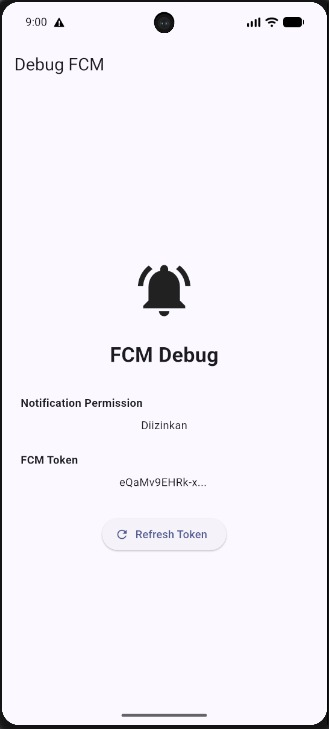 | 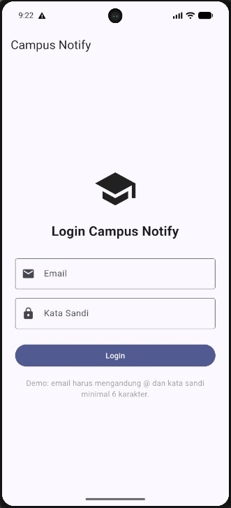 | 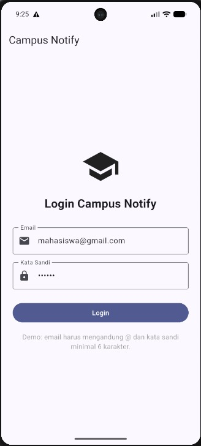 |

# Praktikum 2

| Foreground | Background | Terminated |
|---|---|---|
| 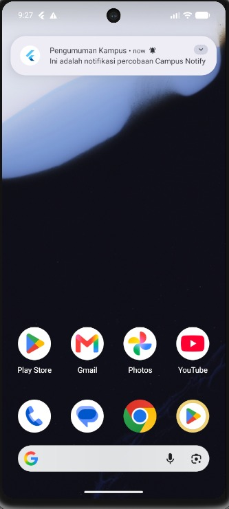 | 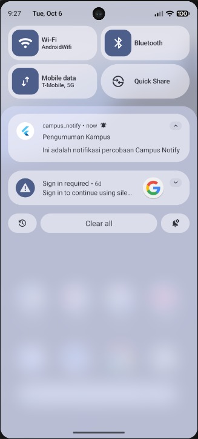 | 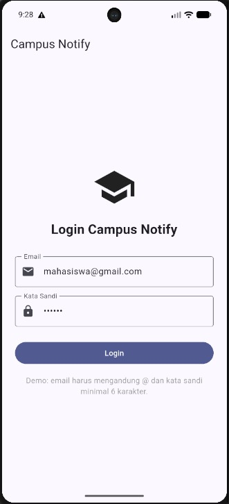|

# Praktikum 3

| Foreground | Background | 
|---|---|
| 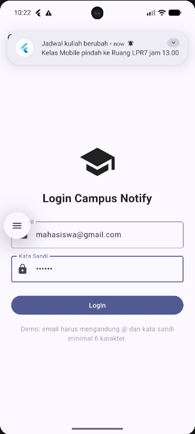 | 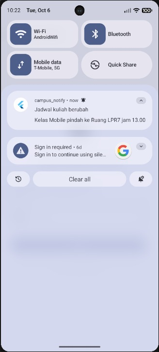 |

| Terminated | Tombol di Terminated |
|---|---|
| 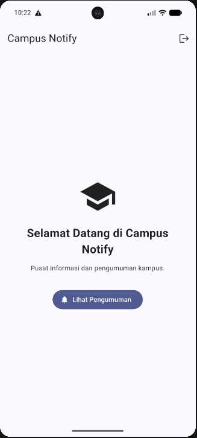 | 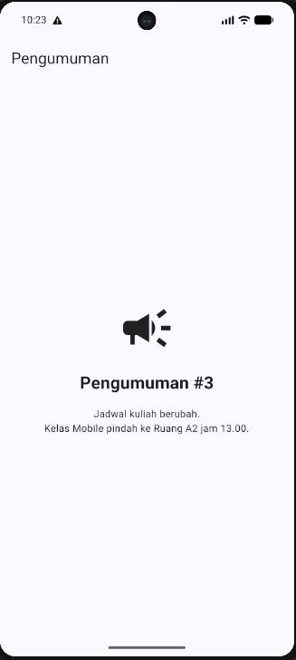 |

# AI Challenge

Dokumentasi AI Challenge:

[Dokumentasi AI](docs/)

# Refactoring, testing, dan error umum

| Analyze | Test |
|---|---|
| 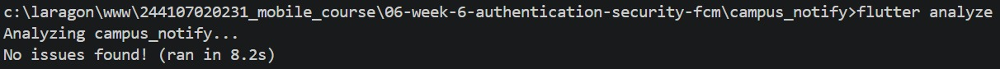 | 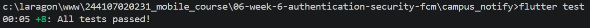 |

# Refleksi

### 1. Mengapa refresh token tidak boleh disimpan di SharedPreferences? Apa risikonya bila bocor?

Refresh token sebaiknya tidak disimpan di SharedPreferences karena SharedPreferences ditujukan untuk penyimpanan data sederhana dan bukan sebagai tempat penyimpanan credential yang sensitif. Refresh token memiliki umur lebih panjang dibandingkan access token dan dapat digunakan untuk mendapatkan access token baru.

Pada project Campus Notify, refresh token disimpan menggunakan `flutter_secure_storage` agar penyimpanannya lebih terlindungi. Jika refresh token bocor, orang lain berpotensi menggunakannya untuk mendapatkan access token baru dan mengakses akun pengguna tanpa harus mengetahui password.

### 2. Apa yang rusak bila `onTokenRefresh` diabaikan selama satu semester perkuliahan?

Token FCM tidak selalu bersifat permanen. Token dapat berubah, misalnya setelah aplikasi di-install ulang, data aplikasi dihapus, atau terjadi perubahan tertentu pada perangkat.

Jika `onTokenRefresh` diabaikan, backend dapat menyimpan token lama. Akibatnya, ketika kampus mengirim notifikasi, perangkat pengguna mungkin tidak lagi menerima notifikasi tersebut.

Pada project Campus Notify, `onTokenRefresh` digunakan untuk mengirim token terbaru ke backend melalui mekanisme `POST /devices`. Dengan demikian, backend dapat memperbarui token perangkat pengguna.

### 3. Kapan memakai topik dan kapan memakai token perangkat?

**Topic** digunakan ketika pesan ditujukan kepada banyak pengguna dengan kategori yang sama atau bersifat broadcast.

Pada project ini digunakan topic:

`pengumuman-kampus`

Sedangkan **token perangkat** digunakan untuk pesan yang bersifat personal dan hanya ditujukan kepada perangkat pengguna tertentu.

Pesan personal tidak sebaiknya menggunakan topic karena pengguna lain yang berlangganan topic tersebut juga dapat menerima pesan.

### 4. Bagian mana dari draf AI yang ditolak atau diperbaiki, dan mengapa?

Draf AI tidak langsung digunakan tanpa pengujian. Beberapa bagian diperiksa dan diperbaiki secara manual berdasarkan hasil `flutter analyze`, `flutter test`, dan pengujian langsung pada emulator.

Perbaikan yang dilakukan antara lain:

1. **Foreground notification**

   FCM tidak otomatis menampilkan banner ketika aplikasi sedang terbuka. Oleh karena itu, `onMessage` diperbaiki agar menampilkan local notification menggunakan `flutter_local_notifications`.

2. **Klik notification**

   Handler `onMessageOpenedApp` digunakan untuk kondisi background, sedangkan `getInitialMessage()` digunakan untuk kondisi terminated. Keduanya meneruskan `data.route` ke GoRouter.

3. **Local notification click**

   Payload route disimpan melalui `pendingDeepLink` jika router belum siap. Setelah router siap, route tersebut diteruskan untuk melakukan navigasi.

4. **Background handler**

   Background handler dipastikan berupa fungsi top-level dengan `@pragma('vm:entry-point')`. Handler tidak menggunakan `BuildContext`, Riverpod, atau GoRouter karena berjalan pada isolate terpisah.

5. **Token lifecycle**

   `getToken()` digunakan untuk memperoleh token awal dan `onTokenRefresh` digunakan untuk memantau perubahan token. Token terbaru kemudian dikirim ke backend.

6. **Pengujian**

   Draf AI tidak dianggap benar hanya berdasarkan kode. Perilaku FCM dibuktikan melalui pengujian langsung pada emulator untuk kondisi foreground, background, dan terminated.

Kesimpulannya, AI digunakan sebagai alat untuk membantu membuat draf awal, tetapi keputusan akhir tetap dilakukan berdasarkan hasil analisis kode dan pengujian aplikasi.