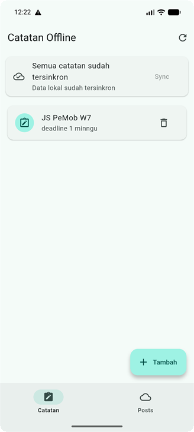
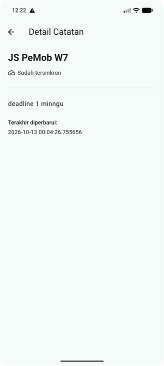
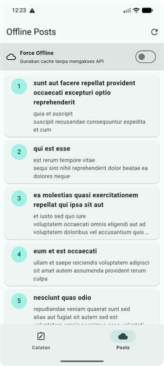
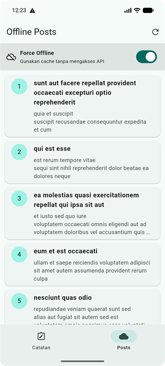

# Laporan Praktikum 07 — Clean Architecture

| Keterangan | Data |
|---|---|
| Nama | Sileysa Faedatul Nuraini |
| NIM | 244107020231 |
| Kelas | TI-3F |
| Mata Kuliah | Pemrograman Mobile |
| Pertemuan | Minggu 7 |

Project ini merupakan refactor feature-first dari project Flutter Minggu 5
(`week5_offline_notes`), bukan aplikasi atau fitur bisnis baru. Project Week 7 berisi struktur
Flutter yang dapat dijalankan secara mandiri.

## Tujuan praktikum

- Memisahkan kode menjadi presentation, domain, dan data.
- Menjaga domain bebas dari framework dan detail persistence/network.
- Memisahkan entity dari model SQLite/API.
- Menggunakan repository interface dan dependency injection Riverpod.
- Menguji use case dengan repository palsu, tanpa database atau jaringan.

## Arsitektur dan arah dependency

```text
lib/
├── core/
│   ├── failures.dart
│   └── format.dart
├── features/
│   ├── notes/
│   │   ├── domain/
│   │   │   ├── entities/note.dart
│   │   │   ├── repositories/note_repository.dart
│   │   │   └── usecases/
│   │   │       ├── get_notes.dart
│   │   │       └── sync_notes.dart
│   │   ├── data/
│   │   │   ├── models/note_model.dart
│   │   │   └── repositories/note_repository_impl.dart
│   │   └── presentation/
│   │       ├── providers/notes_providers.dart
│   │       └── widgets/note_tile.dart
│   └── posts/
│       ├── domain/
│       │   ├── entities/post.dart
│       │   ├── repositories/post_repository.dart
│       │   └── usecases/get_remote_posts.dart
│       ├── data/
│       │   ├── models/post_model.dart
│       │   └── repositories/post_repository_impl.dart
│       └── presentation/providers/posts_providers.dart
├── pages/
│   ├── notes_page.dart
│   ├── note_detail_page.dart
│   └── offline_posts_page.dart
└── providers/app_providers.dart

presentation ───────> domain <─────── data
                           ^
                 data implements domain contracts
```

Domain memiliki entity, kontrak repository, use case, dan `Failure`. Data mengimplementasikan
kontrak tersebut menggunakan sqflite/Dio dan memetakan model ke entity. Presentation berisi
page, provider, dan notifier. Provider Riverpod adalah composition root yang memasangkan
interface dengan implementasi.

### Keputusan desain

- Entity `Note` dan `Post` murni Dart, tanpa `toMap`, `fromMap`, atau `toJson`.
- `NoteModel` dan `PostModel` menangani pemetaan SQLite/API.
- Repository mengubah kegagalan storage/network menjadi `Failure` dengan pesan yang aman
  ditampilkan, bukan membocorkan exception teknis ke UI.
- `GetNotes` memisahkan operasi baca yang diuji dengan fake repository.
- `SyncNotes` menjadi use case karena mengorkestrasi pembacaan dirty count dan perubahan status.
- Add/delete notes tetap langsung dari notifier ke repository interface; use case satu-baris
  tidak ditambahkan jika tidak menambahkan aturan bisnis.
- Posts mempertahankan cache SQLite dan mode Force Offline.

Prompt AI, draf usulan, tabel usulan-versus-keputusan, serta trade-off didokumentasikan di
[docs/clean-architecture-ai-challenge.md](docs/clean-architecture-ai-challenge.md).

## Fitur aplikasi

- **Notes:** menampilkan, menambah, menghapus, dan membuka detail catatan lokal.
- **Dirty flag dan sync:** catatan baru ditandai belum tersinkron; tombol Sync menjalankan
  simulasi sinkronisasi lokal.
- **Offline Posts:** mengambil posts dari API, menyimpan cache SQLite, dan menyediakan toggle
  Force Offline.
- **Preferensi:** mempertahankan fitur tema/pengaturan dari project asal.

## Screenshot aplikasi

Ini adalah bukti kondisi **after refactor**.

| Daftar notes | Detail note |
|---|---|
|  |  |

| Posts online | Posts dengan Force Offline aktif |
|---|---|
|  |  |

### Notes sebelum dan sesudah sinkronisasi

| Sebelum sync | Sesudah sync |
|---|---|
|  |  |

### Posts online dan offline

| Posts online | Posts offline (Force Offline aktif) |
|---|---|
|  |  |

### Screenshot praktikum tambahan

| Daftar notes | Daftar posts |
|---|---|
|  |  |

### Screenshot hasil pemeriksaan yang tersedia

| Flutter analyze | Hasil test model | Hasil seluruh test |
|---|---|---|
|  |  |  |

## Hasil dependency checks

Pemeriksaan di folder Week 7:

1. Presentation (`lib/features/*/presentation`, `lib/pages`, dan `lib/widgets`) terhadap akses
   langsung Dio, database, secure storage, SharedPreferences, dan JSON: **0 hasil**.
2. Domain dan `lib/core` terhadap import Flutter, Dio, sqflite, dan Firebase: **0 hasil**.
3. `flutter analyze --no-pub`: **No issues found**.
4. `flutter test --no-pub`: **8 tests passed**.

## Refleksi

### 1. Mengapa interface repository berada di domain, bukan di data?

Domain mendefinisikan kebutuhan bisnis aplikasi, misalnya mengambil atau menyimpan catatan.
Karena itu, domain yang memiliki kontrak `NoteRepository`; lapisan data kemudian memenuhi
kontrak tersebut dengan SQLite. Jika interface justru berada di data, domain harus bergantung
pada lapisan yang seharusnya menjadi detail implementasi. Akibatnya penggantian SQLite dengan
implementasi lain atau fake untuk test akan lebih sulit dan arah dependency menjadi terbalik.

### 2. Kapan use case dibutuhkan, dan kapan repository langsung ke notifier cukup?

Use case berguna saat sebuah aksi memiliki aturan bisnis, menggabungkan beberapa operasi
repository, atau perlu menjadi unit yang dapat diuji tersendiri. Pada project ini, `SyncNotes`
mengorkestrasi pemeriksaan dirty count dan penandaan catatan tersinkron, sedangkan `GetNotes`
menjadi batas operasi baca yang diuji dengan fake repository. Untuk operasi sederhana seperti
add dan delete yang hanya meneruskan argumen ke repository, notifier dapat memanggil kontrak
repository secara langsung.

### 3. Apa biaya over-engineering use case untuk setiap CRUD satu-baris?

Use case tanpa aturan tambahan menambah file, class, dependency wiring, dan tempat navigasi
kode tanpa memberi perilaku atau perlindungan baru. Untuk tim kecil dan aplikasi CRUD sederhana,
boilerplate ini bisa membuat perubahan kecil lebih lambat dipahami dan dirawat. Abstraksi
tersebut sepadan bila aturan bisnis mulai berkembang, operasi dipakai ulang, atau isolasi test
memang memberikan manfaat nyata.

### 4. Bagian mana dari usulan AI yang disederhanakan atau ditolak?

Saya tidak membuat use case untuk setiap operasi CRUD satu-baris. Add dan delete tetap
dilakukan oleh notifier melalui `NoteRepository`, karena keduanya belum memiliki aturan bisnis
yang layak dipisahkan. Saya juga mempertahankan fitur posts yang memang sudah ada dan
memindahkan batas API/cache ke repository fitur posts; tidak menambah fitur baru. Pemisahan
lapisan tetap diterapkan pada notes dan posts, tetapi jumlah abstraksi dijaga sesuai kebutuhan
project.
