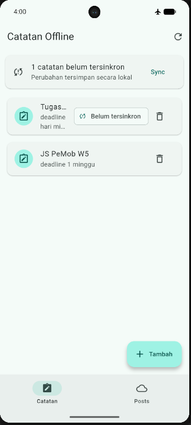
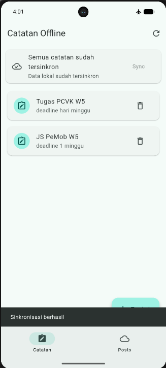
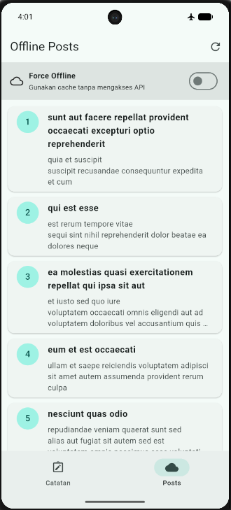
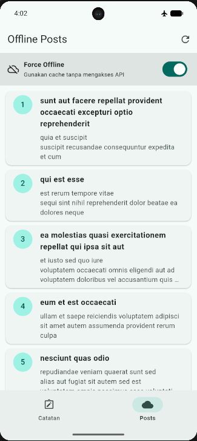
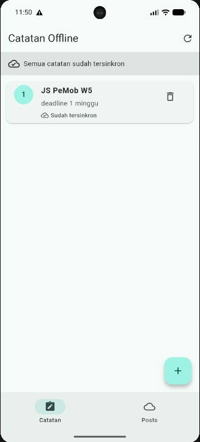
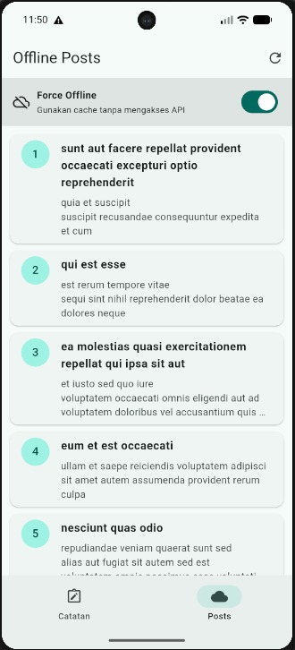
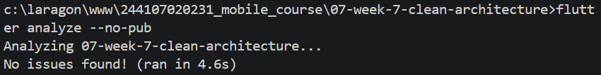
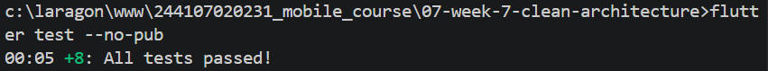
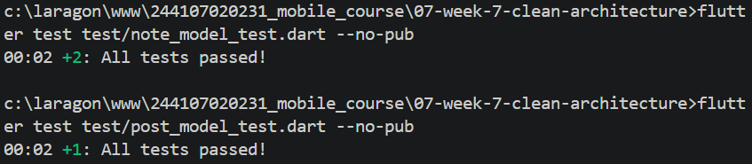

# Laporan Praktikum 07 — Clean Architecture

| Keterangan | Data |
|---|---|
| Nama | Sileysa Faedatul Nuraini |
| NIM | 244107020231 |
| Kelas | TI-3F |
| Mata Kuliah | Pemrograman Mobile |
| Pertemuan | Minggu 7 |

Project ini merupakan refactor feature-first dari project Flutter Minggu 5
(`week5_offline_notes`), bukan aplikasi atau fitur bisnis baru. Project Week 7 berisi struktur
Flutter yang dapat dijalankan secara mandiri.

## Tujuan praktikum

- Memisahkan kode menjadi presentation, domain, dan data.
- Menjaga domain bebas dari framework dan detail persistence/network.
- Memisahkan entity dari model SQLite/API.
- Menggunakan repository interface dan dependency injection Riverpod.
- Menguji use case dengan repository palsu, tanpa database atau jaringan.

## Arsitektur dan arah dependency

```text
lib/
├── core/
│   ├── failures.dart
│   └── format.dart
├── features/
│   ├── notes/
│   │   ├── domain/
│   │   │   ├── entities/note.dart
│   │   │   ├── repositories/note_repository.dart
│   │   │   └── usecases/
│   │   │       ├── get_notes.dart
│   │   │       └── sync_notes.dart
│   │   ├── data/
│   │   │   ├── models/note_model.dart
│   │   │   └── repositories/note_repository_impl.dart
│   │   └── presentation/
│   │       ├── providers/notes_providers.dart
│   │       └── widgets/note_tile.dart
│   └── posts/
│       ├── domain/
│       │   ├── entities/post.dart
│       │   ├── repositories/post_repository.dart
│       │   └── usecases/get_remote_posts.dart
│       ├── data/
│       │   ├── models/post_model.dart
│       │   └── repositories/post_repository_impl.dart
│       └── presentation/providers/posts_providers.dart
├── pages/
│   ├── notes_page.dart
│   ├── note_detail_page.dart
│   └── offline_posts_page.dart
└── providers/app_providers.dart

presentation ───────> domain <─────── data
                           ^
                 data implements domain contracts
```

Domain memiliki entity, kontrak repository, use case, dan `Failure`. Data mengimplementasikan
kontrak tersebut menggunakan sqflite/Dio dan memetakan model ke entity. Presentation berisi
page, provider, dan notifier. Provider Riverpod adalah composition root yang memasangkan
interface dengan implementasi.

### Keputusan desain

- Entity `Note` dan `Post` murni Dart, tanpa `toMap`, `fromMap`, atau `toJson`.
- `NoteModel` dan `PostModel` menangani pemetaan SQLite/API.
- Repository mengubah kegagalan storage/network menjadi `Failure` dengan pesan yang aman
  ditampilkan, bukan membocorkan exception teknis ke UI.
- `GetNotes` memisahkan operasi baca yang diuji dengan fake repository.
- `SyncNotes` menjadi use case karena mengorkestrasi pembacaan dirty count dan perubahan status.
- Add/delete notes tetap langsung dari notifier ke repository interface; use case satu-baris
  tidak ditambahkan jika tidak menambahkan aturan bisnis.
- Posts mempertahankan cache SQLite dan mode Force Offline.

Prompt AI, draf usulan, tabel usulan-versus-keputusan, serta trade-off didokumentasikan di
[docs/clean-architecture-ai-challenge.md](docs/clean-architecture-ai-challenge.md).

## Fitur aplikasi

- **Notes:** menampilkan, menambah, menghapus, dan membuka detail catatan lokal.
- **Dirty flag dan sync:** catatan baru ditandai belum tersinkron; tombol Sync menjalankan
  simulasi sinkronisasi lokal.
- **Offline Posts:** mengambil posts dari API, menyimpan cache SQLite, dan menyediakan toggle
  Force Offline.
- **Preferensi:** mempertahankan fitur tema/pengaturan dari project asal.

## Screenshot aplikasi

Screenshot di bawah adalah bukti UI/fungsi aplikasi project asal Minggu 5 yang ikut disalin
ke folder Week 7. Screenshot ini mendokumentasikan state aplikasi (misalnya sebelum/sesudah
sync dan online/offline), **bukan pasangan tangkapan khusus sebelum/sesudah perubahan
arsitektur Week 7**.

### Notes sebelum dan sesudah sinkronisasi

| Sebelum sync | Sesudah sync |
|---|---|
|  |  |

### Posts online dan offline

| Posts online | Posts offline (Force Offline aktif) |
|---|---|
|  |  |

### Screenshot praktikum tambahan

| Daftar notes | Daftar posts |
|---|---|
|  |  |

Screenshot `Prak3_3.png`, `Prak3_4.png`, dan `Prak3_5.png` juga tersedia di folder
[screenshots](screenshots/).

### Screenshot hasil pemeriksaan yang tersedia

| Flutter analyze | Hasil test model | Hasil seluruh test |
|---|---|---|
|  |  |  |

Catatan: screenshot terminal tersebut merupakan dokumentasi yang sudah tersedia di project
asal. Verifikasi ulang project Week 7 dilakukan dengan perintah di bawah. Screenshot khusus
before/after refactor arsitektur dan pengujian manual pada emulator belum direkam; jangan
menganggap gambar state aplikasi di atas sebagai bukti visual perubahan folder/kode.

## Teknologi

- Flutter dan Dart
- Riverpod
- GoRouter
- sqflite dan path
- Dio
- SharedPreferences

## Menjalankan aplikasi

Prasyarat: Flutter SDK serta emulator Android aktif atau perangkat tersambung.

Dari PowerShell:

```powershell
cd C:\laragon\www\244107020231_mobile_course\07-week-7-clean-architecture
flutter pub get
flutter devices
flutter run
```

Jika ada lebih dari satu target, pilih ID dari `flutter devices`:

```powershell
flutter run -d <device-id>
```

## Menjalankan verifikasi

```powershell
flutter analyze
flutter test
```

Test domain tidak menggunakan SQLite, Dio, atau Firebase. Test yang tersedia:

- `test/get_notes_test.dart`: GetNotes sukses dan meneruskan failure menggunakan fake.
- `test/note_model_test.dart`: default field dan mapping SQLite.
- `test/post_model_test.dart`: mapping API/cache ke entity.
- `test/format_test.dart`: parsing ID rute dan format tanggal.
- `test/widget_test.dart`: halaman utama menggunakan repository palsu.

## Hasil dependency checks

Pemeriksaan di folder Week 7:

1. Presentation (`lib/features/*/presentation`, `lib/pages`, dan `lib/widgets`) terhadap akses
   langsung Dio, database, secure storage, SharedPreferences, dan JSON: **0 hasil**.
2. Domain dan `lib/core` terhadap import Flutter, Dio, sqflite, dan Firebase: **0 hasil**.
3. `flutter analyze --no-pub`: **No issues found**.
4. `flutter test --no-pub`: **8 tests passed**.

Untuk screenshot khusus tugas, jalankan aplikasi versi asal dan versi Week 7 pada kondisi/data
yang sebanding, ambil layar notes dan posts, lalu simpan masing-masing pasangan di
`screenshots/` dengan nama `notes-before-refactor.png`, `notes-after-refactor.png`,
`posts-before-refactor.png`, dan `posts-after-refactor.png`.
