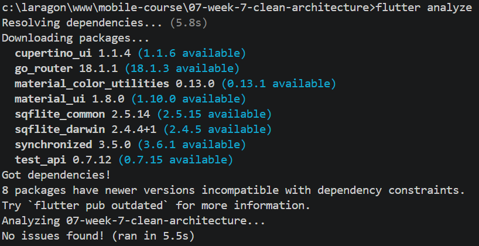
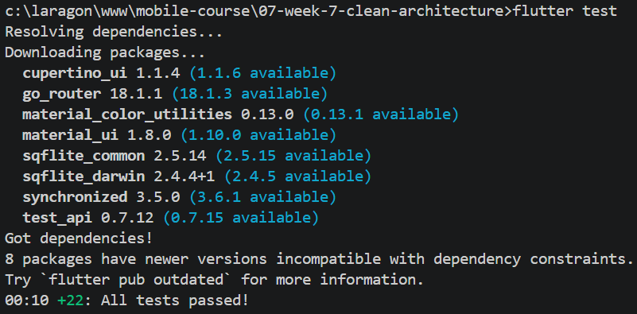

# Laporan Praktikum 08 — Mid Project Review & Code Review

| Keterangan | Data |
|---|---|
| Nama | Sileysa Faedatul Nuraini |
| NIM | 244107020231 |
| Kelas | TI-3F |
| Mata Kuliah | Pemrograman Mobile |
| Pertemuan | Minggu 8 |

Folder ini adalah **laporan Minggu 8**, bukan project Flutter baru. Project
yang direview adalah `07-week-7-clean-architecture` (refactor feature-first
dari `week5_offline_notes`). Semua bukti (analyze, test, grep, screenshot,
AI review) dikumpulkan di folder ini.

## 1. Status Paruh Semester

| Aspek | Status | Bukti |
|-------|--------|-------|
| Struktur feature-first | ✅ | `features/notes/` dan `features/posts/` di week 7 |
| Domain steril dari Flutter | ✅ | grep kosong — `screenshots/grep-domain-sterile.png` |
| Domain steril dari Dio | ✅ | grep kosong — `screenshots/grep-domain-sterile.png` |
| Domain steril dari SQLite | ✅ | grep kosong — `screenshots/grep-domain-sterile.png` |
| `flutter analyze` | ✅ | "No issues found!" — `screenshots/flutter-analyze.png` |
| `flutter test` | ✅ | `[GANTI: "+N: All tests passed!"]` — `screenshots/flutter-test.png` |
| Git log bersih | ✅ | merge PR #3 (`81d6224`) di atas — `screenshots/git-log.png` |
| Issue #4 ditutup via PR | ✅ | issue tracker |
| AI review terdokumentasi | ✅ | `docs/ai-review-vs-keputusan.md` (2 diterima, 3 ditolak) |
| Portfolio minggu 1–7 terlacak | ✅ | 8 project (lihat Peta Project) |

## 2. Peta Project Minggu 1–7

Verifikasi ulang dengan `git ls-files "**/pubspec.yaml"` → 8 baris:

| Minggu | Folder | Tema |
|--------|--------|------|
| 1 | `01-week-1-mobile-development-ecosystem-flutter-refresh` | Flutter refresh |
| 2 | `02-week-2-declarative-ui-responsive-design` | Declarative UI & responsive |
| 3 | `03-week-3-navigation-state-management/week3_navigation` | Navigation |
| 3 | `03-week-3-navigation-state-management/week3_todo` | Riverpod state |
| 4 | `04-week-4-networking-rest-api/week4_api` | REST API + Dio |
| 5 | `05-week-5-local-storage-offline-first/week5_offline_notes` | SQLite offline-first |
| 6 | `06-week-6-authentication-security-fcm/campus_notify` | Auth + FCM |
| 7 | `07-week-7-clean-architecture` | Clean Architecture |

## 3. Peta Issue / PR Minggu 8

| Item | Judul | Status |
|------|-------|--------|
| Issue #4 | AI Prompt Challenge — review PR #2 | Closed via PR #3 |
| PR #2 | `feature/notes-validation` → `develop` | Merged |
| PR #3 | Merge PR #2 ke `develop` (`81d6224`) | Merged |
| PR docs | `docs/ai-review-keputusan` → `develop` | `[GANTI: Open/Merged]` |

## 4. Project yang Direview — Week 7 Clean Architecture

Detail lengkap ada di [`../07-week-7-clean-architecture/README.md`](../07-week-7-clean-architecture/README.md).
Ringkasnya:

- **Refactor feature-first** dari `week5_offline_notes`; bukan aplikasi baru.
- **Domain murni Dart**: entity `Note`/`Post` tanpa `toMap`/`fromMap`/`toJson`.
- **Data** mengimplementasikan kontrak domain via sqflite/Dio.
- **Presentation** berisi page, provider Riverpod (composition root), dan widget.
- **Use case** yang dipertahankan: `GetNotes`, `SyncNotes`, `GetRemotePosts`.
  Add/delete notes langsung dari notifier ke repository (keputusan sadar,
  didokumentasikan di refleksi week 7).

### Fitur Week 7 yang direview

- **Notes** — tampil, tambah, hapus, buka detail; validasi judul kosong
  (`ValidationFailure`) ditambahkan di PR #2.
- **Dirty flag & sync** — catatan baru ditandai belum tersinkron; tombol Sync
  menjalankan simulasi sinkronisasi lokal.
- **Offline Posts** — ambil dari JSONPlaceholder, cache SQLite, toggle Force
  Offline.
- **Preferensi** — tema/pengaturan dari project asal.

## 5. AI Review Minggu 8 — PR #2

Prompt dan output lengkap ada di [`docs/ai-review-vs-keputusan.md`](docs/ai-review-vs-keputusan.md).

Ringkasan keputusan (5 temuan AI → **2 diterima, 3 ditolak**):

| # | Temuan | Level | Keputusan |
|---|--------|-------|-----------|
| 1 | `ValidationFailure` bocor ke presentation | blocker arsitektur | **Diterima** |
| 2 | `_isSaving` stuck jika `onSubmit` throw | saran | **Ditolak** (grep `throw` kosong) |
| 3 | `body` tidak di-trim di domain | saran | **Ditolak** (pilihan desain multi-line) |
| 4 | Test tidak verify repo tidak dipanggil | saran test | **Diterima** |
| 5 | Assert `message` bukan `isA<ValidationFailure>` | saran style | **Ditolak** (kontrak use case) |

> **Catatan penting:** AI review minggu 8 ini **berbeda** dari AI Challenge
> minggu 7 (audit refactor `campus_notify`). AI minggu 7 = usulan migrasi;
> AI minggu 8 = review PR nyata di repo ini.

## 6. Bukti Mesin Hijau

| Analyze | Test |
|---|---|
|  |  |

## 7. Refleksi

**Apa beda LGTM buta dengan approve yang bertanggung jawab? Apa risikonya bagi tim?**

> LGTM buta = approve tanpa checkout dan tanpa jalankan test. Approve
> bertanggung jawab = reviewer checkout branch, jalankan `flutter analyze`
> + `flutter test`, reproduksi minimal 1 perilaku, dan mengonfirmasi tiap
> komentar ditindaklanjuti. Risiko LGTM buta: bug lolos ke develop dan
> penulis kehilangan sinyal untuk memperbaiki.

**Kapan komentar wajib berstatus request changes, dan kapan cukup saran?**

> Request changes untuk blocker (melanggar dependency rule, bug nyata,
> test merah, `analyze` tidak bersih). Saran untuk hardening, keterbacaan,
> dan test yang belum menutup edge case tapi tidak menghambat merge.
> Di PR ini, temuan #1 layak request changes (blocker arsitektur); #4 saran
> karena test tetap lulus walau overpromise.

**Bagian mana dari review AI yang kamu tolak atau sederhanakan, dan mengapa?**

> Kami menolak temuan #2 (grep kosong: tidak ada `throw` di data layer),
> temuan #3 (trim body adalah pilihan desain untuk multi-line), dan
> temuan #5 (mengunci tipe `ValidationFailure` justru kontrak use case,
> bukan cacat). Tiga penolakan punya alasan teknis tertulis dan bukti
> grep — bukan berdasarkan "AI-nya kurang yakin".

**Satu hal konkret yang kamu perbaiki setelah review sejawat — apa dampaknya?**

> Setuju, terima kasih. Duplikasi sudah dihapus di commit a1b0c1d: dialog sekarang memanggil use case dan menampilkan failure.message di kolom judul, jadi UI tidak lagi mengetahui aturan validasinya. Dialog tetap terbuka saat error sehingga isi catatan tidak hilang. Sudah diuji manual (judul kosong dan 3 spasi), screenshot terlampir.