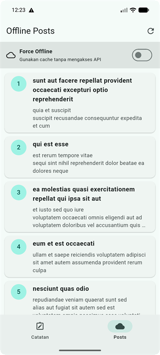

# Week 8 — Mid-project Review & Code Review

| Keterangan | Data |
|---|---|
| Nama | Sileysa Faedatul Nuraini |
| NIM | 244107020231 |
| Kelas | TI-3F |
| Mata Kuliah | Pemrograman Mobile |
| Pertemuan | Minggu 8 |

## Status paruh semester

Project yang direview adalah aplikasi Offline Notes dan Offline Posts hasil refactor
Week 7, bukan project baru. Perilaku bisnis dipertahankan, perubahan Week 8 menambah
guard lifecycle untuk request posts yang selesai setelah provider dibuang dan test regresi
untuk jalur tersebut.

## Peta project dan fitur

Folder Week 8 sekarang berisi **salinan runnable project Flutter Week 7** di `app/` beserta
dokumen review Week 8. Ini tetap kelanjutan aplikasi Week 5–7, bukan project bisnis baru.

Isi folder Week 8:

```text
08-week-8-mid-project-review/
├── README.md
├── app/
│   ├── pubspec.yaml
│   ├── lib/
│   ├── test/
│   ├── android/
│   ├── ios/
│   ├── web/
│   ├── linux/
│   ├── macos/
│   ├── windows/
│   ├── docs/
│   └── screenshots/
├── .github/
│   ├── pull_request_template.md
│   └── workflows/ci.yml
├── docs/
│   ├── ai-review-prompt.md
│   ├── ai-review-output.md
│   ├── ai-review-vs-keputusan-final.md
│   ├── review-checklist.md
│   └── verification-results.md
└── screenshots/
    ├── notes-after-refactor-2026-10-13.png
    ├── posts-after-refactor-2026-10-13.png
    └── posts-offline-after-refactor-2026-10-13.png
```

`app/` adalah salinan source project Week 7. Salinan ini mengecualikan cache dan output
generated seperti `.dart_tool/`, `build/`, Gradle cache, serta file konfigurasi SDK lokal.
Perbaikan lifecycle dan regression test Week 8 sudah termasuk di salinan ini.

Fitur utama:

- Notes lokal dengan SQLite, operasi CRUD, dirty flag, dan simulasi sync.
- Posts dari API dengan cache SQLite dan mode Force Offline.
- Riverpod untuk state management; domain menggunakan repository interface.
- Struktur feature-first dengan pemisahan presentation, domain, dan data.

## Teknologi

Flutter, Dart, Riverpod, SQLite (`sqflite`), Dio, dan GoRouter.

## Cara menjalankan dan memverifikasi

Jalankan perintah dari folder Week 8:

```powershell
cd .\app
flutter pub get
flutter analyze
dart format --set-exit-if-changed lib test
flutter test
flutter run
```

Hasil verifikasi lokal setelah perubahan Week 8 dicatat di
[`docs/verification-results.md`](docs/verification-results.md). CI menjalankan pemeriksaan
yang sama pada Pull Request saat Week 8 menjadi root repository. Jika Week 8 tetap menjadi
subfolder di repository portfolio, GitHub Actions hanya mengenali workflow di `.github/`
root repository portfolio.

## Screenshot





Pemeriksaan formatter dibatasi ke `lib` dan `test` agar tidak menelusuri artefak build
Flutter/Gradle yang dihasilkan di luar source project.

## Dokumen review

- [Checklist mid review](docs/review-checklist.md)
- [Prompt review AI](docs/ai-review-prompt.md)
- [Output awal review AI](docs/ai-review-output.md)
- [Usulan AI vs keputusan final](docs/ai-review-vs-keputusan-final.md)
- [Bukti analyze, format, dan test](docs/verification-results.md)