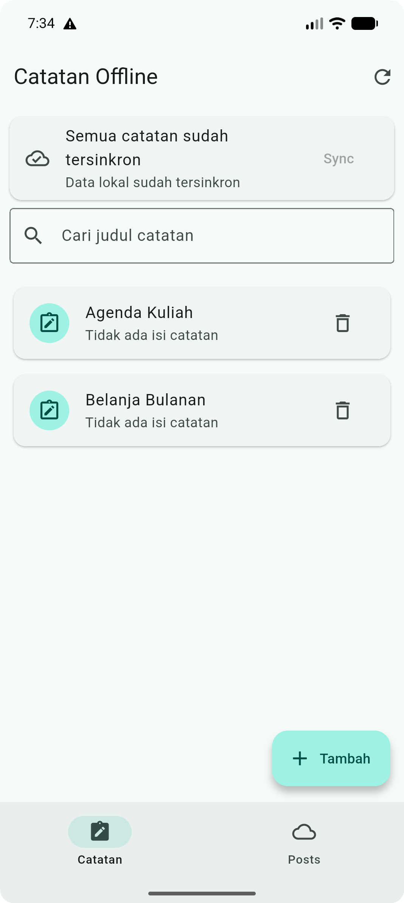
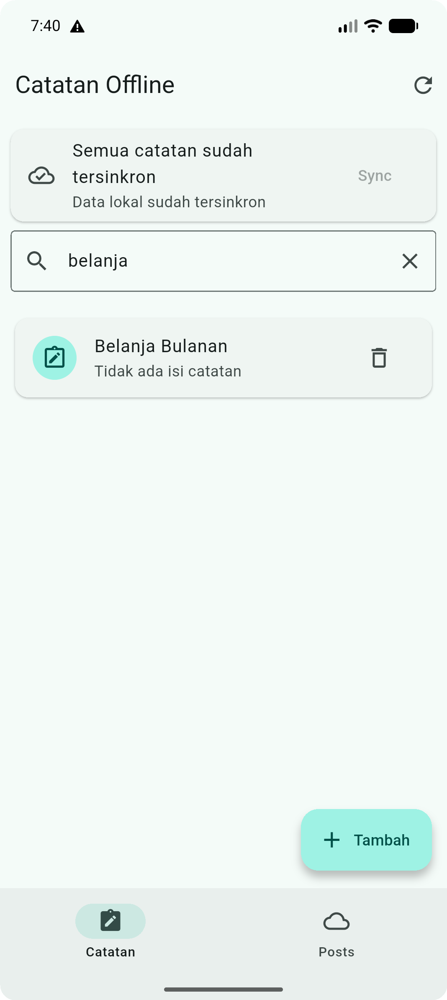
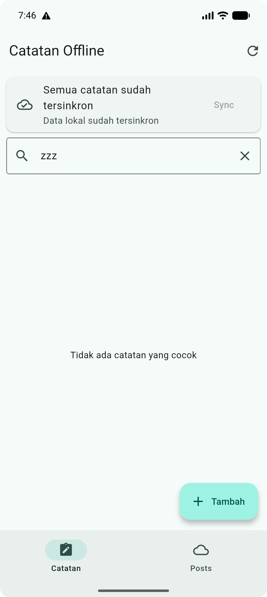

# Laporan Praktikum 09 — AI-assisted Development

| Keterangan | Data |
|---|---|
| Nama | Sileysa Faedatul Nuraini |
| NIM | 244107020231 |
| Kelas | TI-3F |
| Mata Kuliah | Pemrograman Mobile |
| Pertemuan | Minggu 9 |

Project Minggu 9 merupakan kelanjutan aplikasi Offline Notes dan Offline Posts dari
Minggu 8, bukan project atau aplikasi baru. Perubahan utama menambahkan pencarian
substring pada judul notes, tanpa membedakan huruf besar/kecil, dan empty state saat
tidak ada judul yang cocok.

## Tujuan praktikum

- Menggunakan AI sebagai pemberi usulan, bukan sebagai pengganti verifikasi.
- Menempatkan aturan pencarian di use case domain yang dapat diuji tanpa Flutter atau
  database.
- Membuktikan pencarian cocok, tidak cocok, dan empty state dengan unit/widget test.
- Mencatat prompt, hasil awal, keputusan terima/tolak, dan bukti pemeriksaan di
  `docs/ai-log.md`.

## Fitur dan arsitektur

- **Pencarian notes:** mencari substring pada judul; query dinormalisasi agar
  pencocokan tidak peka kapitalisasi.
- **Empty state:** menampilkan pesan saat query tidak menemukan catatan.
- **Pemisahan layer:** UI mengirim query ke `SearchNotes`; filter tidak mengakses
  repository, SQLite, atau API.
- **Fitur sebelumnya:** operasi notes offline dan halaman posts dari project Minggu 8
  tetap dipertahankan.

```text
lib/features/notes/domain/usecases/search_notes.dart
                    ^
                    | dipanggil oleh
lib/pages/notes_page.dart
```

## Teknologi

Flutter, Dart, Riverpod, SQLite (`sqflite`), Dio, dan GoRouter.

## Cara menjalankan dan memverifikasi

Jalankan perintah dari folder project Minggu 9:

```powershell
flutter pub get
flutter analyze
dart format --set-exit-if-changed lib test
flutter test
flutter run
```

Hasil lokal: `flutter analyze` bersih, formatter memeriksa 32 file tanpa perubahan,
dan seluruh 14 test lulus. Rincian prompt dan keputusan AI tersedia di
[`docs/ai-log.md`](docs/ai-log.md).

## Screenshot aplikasi

Bukti di bawah diambil dari emulator Android dengan catatan contoh `Belanja Bulanan`
dan `Agenda Kuliah`. Sudut gambar dibuat sedikit membulat agar konsisten.

| Query kosong | Hasil pencarian cocok |
|---|---|
|  |  |

| Hasil pencarian tidak cocok |
|---|
|  |

## Dokumen praktikum

- [Prompt, hasil awal AI, dan catatan verifikasi](docs/ai-log.md)
- [Source Flutter](lib/)
- [Test](test/)
- [Screenshot aplikasi](screenshots/)
