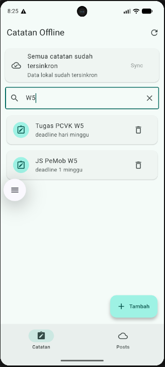
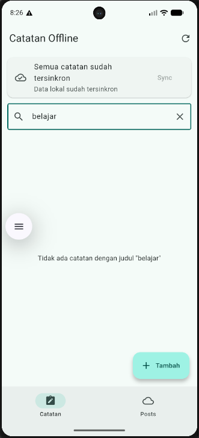
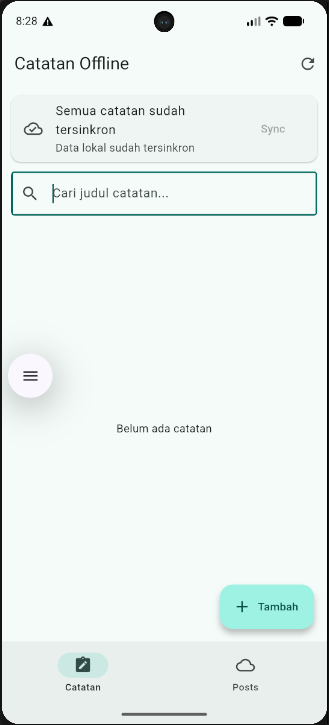
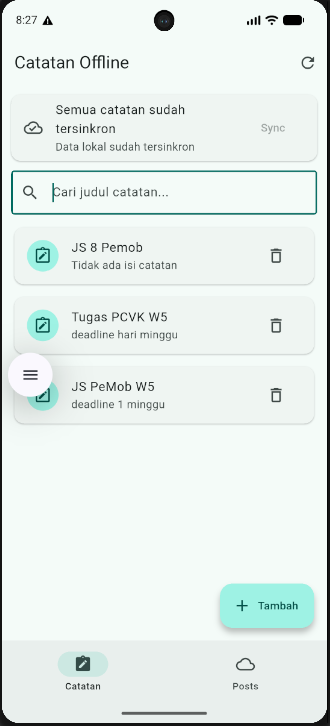
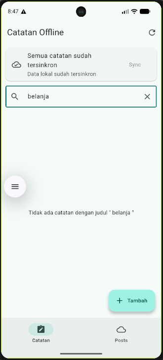
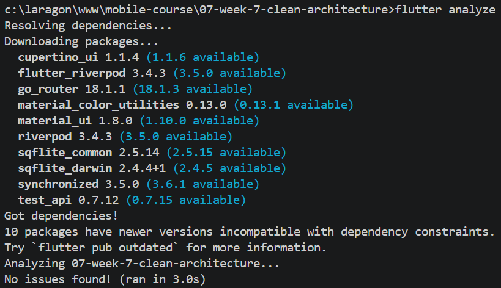
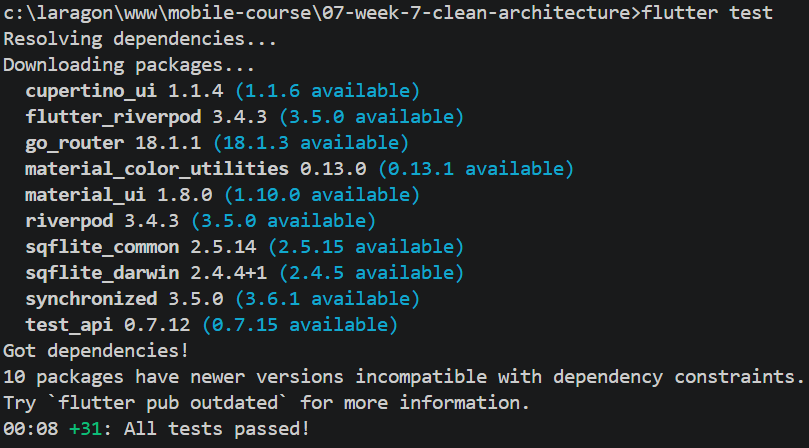

# Laporan Praktikum 09 — AI-Assisted Development / Vibe Coding

| Keterangan | Data |
|---|---|
| Nama | Sileysa Faedatul Nuraini |
| NIM | 244107020231 |
| Mata Kuliah | Pemrograman Mobile |
| Pertemuan | Minggu 9 |

---

# Tujuan

Setelah menyelesaikan codelab ini, mahasiswa mampu:

1. Menjelaskan workflow AI-assisted development (prompt, generate, verify, test, refactor, explain);
2. Menulis prompt dan konteks yang efektif untuk fitur Flutter kecil;
3. Mengenali halusinasi dan keterbatasan AI pada kode Flutter;
4. Melakukan debugging dan refactoring kode hasil AI ke Clean Architecture;
5. Menguji kode hasil AI dengan `flutter analyze` dan test;
6. Mendokumentasikan prompt, hasil AI, keputusan terima/tolak, dan bukti uji di `docs/ai-log.md`.

Fitur yang ditambahkan dengan bantuan AI: **pencarian judul catatan + empty state** pada aplikasi Catatan Offline (project Minggu 7, `07-week-7-clean-architecture`, branch `feature/notes-search`). Stack: Flutter, Riverpod 3, SQLite (`sqflite`), Dio, go_router, dengan arsitektur `presentation -> domain <- data`.

# Praktikum 1 — Prompt dan Generate Fitur

Prompt memakai formula 5 slot (peran, konteks, tugas, batas, output). Konteks yang ditempel: versi package dari `pubspec.yaml`, struktur folder fitur notes, entity `Note`, kontrak `NoteRepository`, contoh gaya use case, serta isi `notes_providers.dart` dan `notes_page.dart`. Tidak ada token, API key, atau secret yang ditempel. Prompt lengkap dan output mentah AI ada di `docs/ai-log.md` bagian 1 dan 2.

| Query cocok (`W5`) | Tidak ada hasil (`belanja`) | Belum ada catatan |
|---|---|---|
|  |  |  |

| Sebelum percobaan | Percobaan ` belanja ` |
|---|---|
|  |  |

Perubahan kode:

| File | Status |
|---|---|
| `domain/usecases/search_notes.dart` | baru (logika filter, Dart murni) |
| `presentation/providers/notes_providers.dart` | diubah (`searchNotesProvider`) |
| `presentation/pages/notes_page.dart` | diubah (kolom search, empty state, list hasil filter) |
| `test/search_notes_test.dart` | baru |
| `test/notes_page_search_test.dart` | baru |

Folder `data/` tidak diubah.

# Praktikum 2 — Verifikasi

Bukti verifikasi (detail di `docs/ai-log.md` bagian 3):

```
findstr ... domain\*.dart         -> kosong (domain bebas Flutter/Dio/sqflite)
findstr ... presentation\*.dart   -> banyak hasil (kontrol, perintah valid)
git diff --stat                   -> hanya notes_page.dart dan notes_providers.dart
flutter analyze                   -> No issues found!
```

Tidak ditemukan method fiktif atau API kadaluarsa; hasil negatif ini dicatat apa adanya.

Temuan format: `dart format --set-exit-if-changed` awalnya menghasilkan `ERRORLEVEL 1` (4 file fitur berubah, 40 file lama bersih), lalu `0` setelah `dart format`.

Perkembangan jumlah test: 25 (awal) → 27 (+2 widget test empty state) → 31 (+2 test probe use case, +2 widget test jalur utama).

# Praktikum 3 — Debug dan Refactor

**Bug yang ditemukan (bukti wajib).** Pesan empty state memakai query mentah (`"$_query"`), sedangkan filter memakai query yang sudah di-`trim()`. Mengetik `  xyz  ` membuat spasi ikut tampil di pesan. Dibuktikan dengan widget test merah, diperbaiki satu baris (`"${_query.trim()}"`), lalu test hijau.

**Refactor.** Kolom search diekstrak dari `build()` menjadi widget privat `_SearchField`. Refactor pertama sempat salah tempat dan ditangkap `flutter analyze` (8 error); setelah diperbaiki, `flutter test` tetap 31 hijau.

# AI Challenge

Dokumentasi AI Challenge (prompt, output AI, tabel usulan vs keputusan, bukti):

[Dokumentasi AI](docs/ai-log.md)

| Temuan AI | Keputusan | Bukti |
|---|---|---|
| Format baris melebihi batas | Terima | `ERRORLEVEL 1` lalu `0` setelah `dart format` |
| Widget test belum cover jalur utama | Terima | 2 widget test baru, total 27 → 31 |
| Use case belum diuji di batas | Terima | 2 test probe hijau |
| `_query` dan controller dobel | Tolak | Tidak ada bug yang bisa direproduksi |
| Filter di `build()` tiap rebuild | Tolak | Tidak ada bukti masalah performa |

# Refactoring, testing, dan error umum

| Analyze | Test |
|---|---|
|  |  |

```
dart format --output=none --set-exit-if-changed lib test   -> 0 changed, ERRORLEVEL 0
flutter analyze                                            -> No issues found!
flutter test                                               -> +31: All tests passed!
```

# Refleksi

### 1. Satu halusinasi AI apa yang Anda temukan dan bagaimana membuktikannya?

Tidak ditemukan method fiktif karena `flutter analyze` bersih, tetapi ditemukan bug logika yang dihasilkan AI: pesan empty state memakai query mentah, sedangkan filter memakai query yang sudah di-`trim()`. Bug ini dibuktikan lewat widget test dengan input `  xyz  `. Test merah (ekspektasi `"xyz"`, ditemukan 0 widget), sedangkan test `xyz` tanpa spasi hijau, sehingga penyebabnya murni spasi. Setelah diperbaiki dengan `_query.trim()`, test menjadi hijau.

### 2. Prompt mana yang paling membantu dan apa yang Anda ubah?

Prompt 5 slot dengan bagian **Batas** yang paling membantu: filter harus di use case domain murni, folder `data/` tidak boleh disentuh, dan hanya dua file lama yang boleh diubah. Batas itu bisa dibuktikan dengan `findstr` dan `git diff --stat`. Hal yang saya ubah dari template awal adalah mengganti placeholder konteks dengan isi file asli (struktur folder, `pubspec.yaml`, kontrak repository, dan kode halaman) supaya AI tidak menebak struktur project.

### 3. Satu refactor apa yang Anda lakukan pada kode AI?

Kolom search di `build()` saya ekstrak menjadi widget privat `_SearchField` yang menerima `controller`, `hasQuery`, `onChanged`, dan `onClear`. Filternya sendiri sudah berada di use case domain `SearchNotes`, dan test widget yang ada menjadi jaring pengaman: setelah refactor, `flutter test` tetap 31 hijau.

### 4. Keputusan terima/tolak mana yang paling sulit?

Keputusan menolak saran memindahkan filter dari `build()` ke provider turunan. Saran itu terdengar benar secara teori karena filter dihitung ulang tiap rebuild. Namun daftar catatan lokal berukuran kecil, tidak ada bukti masalah performa, dan provider turunan menambah aturan invalidasi yang harus dijaga. Karena itu saran ditolak, dan baru ditinjau ulang jika jumlah catatan mencapai ribuan.

---

## Cara menjalankan

```
cd 07-week-7-clean-architecture
flutter pub get
flutter run
```

## Struktur folder

```
09-week-9-ai-assisted-development/
  README.md
  docs/
    ai-log.md
    diff-search.txt
  screenshots/
    01-search-cocok.png
    02-search-kosong.png
    03-belum-ada-catatan.png
    analyze.png
    percobaan_spasi.png
    sebelum_percobaan.png
    test.png
```