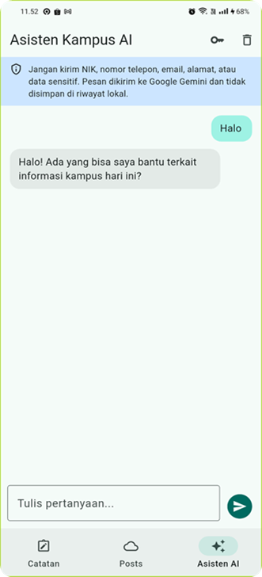
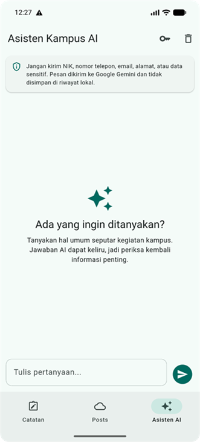
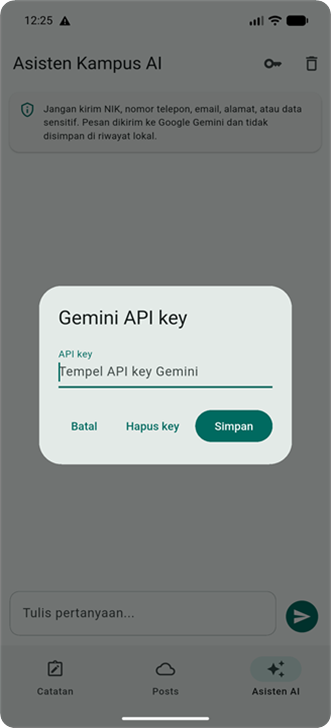

# Laporan Praktikum 10 — AI Feature Integration

| Keterangan | Data |
|---|---|
| Nama | Sileysa Faedatul Nuraini |
| NIM | 244107020231 |
| Kelas | TI-3F |
| Mata Kuliah | Pemrograman Mobile |
| Pertemuan | Minggu 10 |

Project ini melanjutkan aplikasi Offline Notes dan Offline Posts Minggu 9. Fitur baru
adalah chat asisten kampus dengan streaming jawaban dari Gemini; fitur lama tetap
tersedia di tab Catatan dan Posts.

## Fitur dan arsitektur

- **Chat streaming:** jawaban Gemini 3.5 Flash-Lite ditampilkan bertahap melalui
  Server-Sent Events.
- **Penyimpanan API key:** key dimasukkan melalui pengaturan dan disimpan memakai
  `flutter_secure_storage`; key tidak ditulis ke source code atau dikirim sebagai URL.
- **Privasi:** aplikasi memperingatkan pengguna dan memblokir pola umum NIK,
  nomor telepon, email, serta penanda alamat sebelum request dikirim.
- **Batas biaya:** input maksimal 1.200 karakter, konteks maksimal 10 pesan, dan
  maksimal 20 request per sesi aplikasi. Batas ini bukan pengganti kuota di provider.
- **Fallback:** error memiliki pesan yang dapat dipahami, opsi coba lagi, dan arahan
  menggunakan catatan lokal.
- **Riwayat:** percakapan hanya berada di memori selama aplikasi berjalan; tidak
  disimpan di database lokal.

```text
lib/features/ai_chat/
├── domain/
│   ├── entities/chat_message.dart
│   ├── repositories/ai_chat_repository.dart
│   └── usecases/validate_chat_prompt.dart
├── data/gemini_chat_repository.dart
└── presentation/
    ├── providers/ai_chat_provider.dart
    └── pages/chat_page.dart
```

Presentation menggunakan kontrak domain `AiChatRepository`; detail Dio, Gemini,
SSE, dan secure storage berada di data.

## Menjalankan aplikasi

1. Buat API key di Google AI Studio. Jangan menaruh key di source, README, atau Git.
2. Dari folder project ini jalankan:

   ```powershell
   flutter pub get
   flutter run
   ```

3. Buka tab **Asisten AI**, pilih ikon key, lalu simpan API key Gemini.
4. Coba pertanyaan umum tanpa memasukkan informasi pribadi.

Key pada aplikasi mobile tetap dapat diekstrak dari perangkat yang dikompromikan.
`flutter_secure_storage` melindungi penyimpanan lokal, bukan menggantikan backend proxy.
Untuk aplikasi produksi, gunakan backend milik sendiri, batasi kuota per pengguna di
server, dan pantau billing di provider.

## Risiko dan mitigasi

| Risiko | Mitigasi |
|---|---|
| Data pribadi terkirim ke provider | Peringatan di chat dan pemblokiran pola NIK, nomor, email, dan kata alamat. Pemeriksaan pola tidak sempurna; pengguna tetap harus menghapus data pribadi. |
| API key disalahgunakan atau biaya melonjak | Key tidak berada di source/URL, batas input, konteks, serta request per sesi. Terapkan kuota/billing alert di provider; gunakan backend proxy untuk produksi. |
| API lambat, gagal, atau kena rate limit | Timeout, pesan error spesifik, tombol coba lagi, dan fallback ke catatan lokal. |
| Jawaban tidak akurat | Jawaban diberi konteks sebagai saran AI; informasi penting perlu diverifikasi. |
| Percakapan sensitif tersimpan | Percakapan tidak disimpan lokal dan dapat dihapus dari tampilan selama sesi. Provider tetap menerima isi request untuk memprosesnya. |

## Verifikasi

Jalankan dari folder project ini:

```powershell
flutter analyze
dart format --set-exit-if-changed lib test
flutter test
```

Hasil verifikasi di terminal folder ini:

| Perintah | Hasil |
|---|---|
| `flutter analyze` | Lulus — `No issues found!` |
| `dart format --set-exit-if-changed lib test` | Lulus — 42 file diperiksa, tidak berubah. |
| `flutter test` | Lulus — seluruh 25 test passed. |

Test AI memeriksa validasi prompt, pemblokiran data pribadi sebelum request,
penggabungan potongan streaming menggunakan fake repository, timeout stream, serta
dialog API key yang dibuka dan ditutup tanpa error.
Request live Gemini juga berhasil diuji di CPH2387 dengan prompt umum `Halo`.

## Screenshot

Screenshot halaman chat dan dialog API key diambil dari build terbaru di emulator
Android, dengan komponen kartu dan warna teal mengikuti gaya Minggu 8. Respons Gemini
live menggunakan prompt umum `Halo`; screenshot respons tersebut diambil sebelum
penyesuaian visual dan ditampilkan sebagai bukti hasil uji. Ukuran semua screenshot
disamakan dengan screenshot portrait Week 6 (331 x 728 piksel) dan sudutnya tetap
membulat. Tidak ada key atau data pribadi yang terlihat.

| Respons Gemini live (tampilan sebelum penyesuaian visual) | Halaman chat terbaru |
|---|---|
|  |  |



## Refleksi
1. Fitur AI mana yang Anda integrasikan dan mengapa?

Chat asisten kampus dengan jawaban streaming dari Gemini. Saya memilih chat karena pengguna dapat bertanya dengan bahasa sehari-hari dan melihat jawaban muncul bertahap, tanpa perlu menunggu seluruh respons selesai.

2. Bagaimana Anda melindungi privasi pengguna saat menggunakan AI API?

API key disimpan menggunakan flutter_secure_storage, bukan ditulis di source code. Aplikasi mengingatkan pengguna agar tidak mengirim data sensitif dan memblokir beberapa pola umum, seperti NIK, nomor telepon, email, dan kata terkait alamat. Riwayat chat hanya tersimpan sementara di memori aplikasi. Pemeriksaan otomatis ini tidak sempurna, jadi pengguna tetap perlu menghindari membagikan informasi pribadi.

3. Fallback apa yang Anda sediakan jika layanan AI error?

Aplikasi menampilkan pesan error yang sesuai, menyediakan opsi untuk mencoba kembali, dan mengarahkan pengguna ke catatan lokal sebagai alternatif. Request juga memiliki timeout agar aplikasi tidak terus-menerus menunggu respons.

4. Satu hal yang Anda pelajari tentang UX fitur AI di mobile?

Fitur AI sebaiknya memberi umpan balik selama menunggu. Streaming membantu pengguna melihat bahwa jawaban sedang diproses, sementara pesan privasi dan error yang jelas membantu pengguna memahami batasan layanan.


## Dokumen praktikum

- [Prompt, contoh output, dan keputusan verifikasi](docs/ai-log.md)
- [Source Flutter](lib/)
- [Test](test/)
- [Screenshot](screenshots/)
