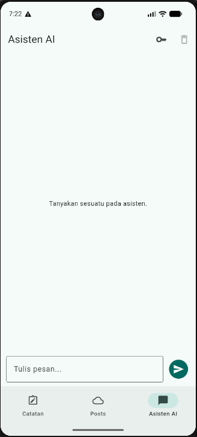
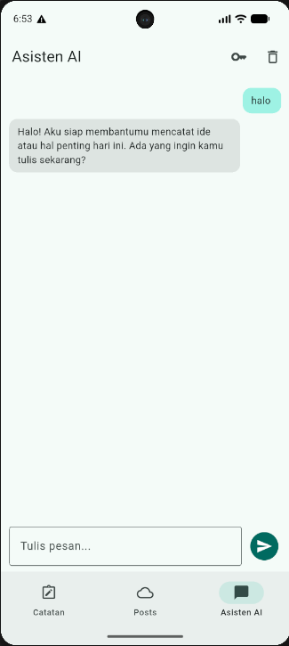
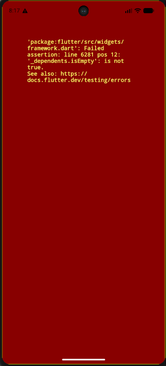
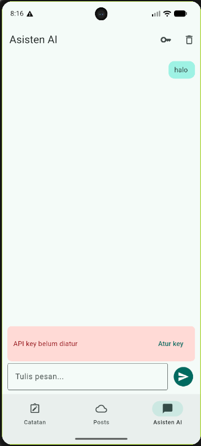

# Laporan Praktikum 10 — Integrasi Fitur AI (Chat Asisten)

| Keterangan | Data |
|---|---|
| Nama | Sileysa Faedatul Nuraini |
| NIM | 244107020231 |
| Mata Kuliah | Pemrograman Mobile |
| Pertemuan | Minggu 10 |

---

# Tujuan

Setelah menyelesaikan codelab ini, mahasiswa mampu:

1. Memahami konsep integrasi LLM API ke aplikasi mobile;
2. Merancang chat interface dengan streaming response;
3. Mengintegrasikan OCR, Speech-to-Text, dan Image Understanding;
4. Menerapkan prompt design yang aman dan efektif;
5. Menangani privasi, biaya, error handling, dan fallback design;
6. Mengevaluasi pengalaman pengguna pada fitur AI.

Pada praktikum ini fitur AI yang diintegrasikan adalah **Chat Asisten**.

# Ringkasan Fitur

Chat Asisten memakai Gemini API dan ditambahkan sebagai tab ketiga ("Asisten")
pada project Notes Minggu 7 (Clean Architecture + Riverpod). Balasan AI
ditampilkan bertahap (streaming), dengan indikator loading, tombol "Coba lagi"
saat gagal, dan dialog untuk mengatur API key.

## Cara menjalankan

1. `flutter pub get`, lalu `flutter run`.
2. Buka tab **Asisten**, tekan ikon kunci, lalu masukkan API key Gemini milik
   sendiri. Key disimpan di `flutter_secure_storage`, tidak ada di kode sumber
   maupun repository.
Catatan: folder `android/` tidak ikut di-commit (diabaikan `.gitignore`).
Jalankan `flutter create .` di folder ini untuk membuat ulang folder platform.
Untuk build release Android, tambahkan izin INTERNET di
`android/app/src/main/AndroidManifest.xml`.

# Bukti Mesin Hijau

- `flutter analyze`: No issues found!
- `flutter test`: 54 tes lolos (31 bawaan Minggu 7 + 23 tes fitur chat)

Tes fitur chat berjalan tanpa internet dan tanpa API key asli, memakai
repository palsu dan `MockClient`.

# Arsitektur

Fitur chat mengikuti pola Minggu 7 (presentation -> domain <- data):

```text
lib/features/chat/
├── domain/
│   ├── entities/chat_message.dart
│   ├── repositories/chat_repository.dart      # abstract
│   └── usecases/
│       ├── send_chat_message.dart             # validasi + ask/stream
│       └── save_ai_api_key.dart
├── data/
│   ├── datasources/ai_service.dart            # HTTP ke Gemini (generate + SSE)
│   └── repositories/chat_repository_impl.dart # exception -> Failure
└── presentation/
    ├── providers/
    │   ├── chat_providers.dart                # dependency injection
    │   └── chat_notifier.dart                 # state percakapan (Notifier)
    └── pages/chat_screen.dart
```

Alasan: lapisan domain tidak mengenal HTTP maupun Gemini, sehingga penyedia AI
dapat diganti tanpa mengubah UI dan logika dapat diuji tanpa internet.
Exception hanya hidup di lapisan data dan diterjemahkan menjadi `Failure`
sebelum sampai ke UI, sama seperti pola `Failure` pada fitur Notes.

# Screenshot

| Tampilan awal | Pertanyaan dan balasan AI |
|---|---|
|  |  |

| Error: model tidak ditemukan (404) | Error: API key belum diatur |
|---|---|
|  |  |

# Prompt Design

Prompt sistem yang dipakai:

> Kamu asisten catatan yang ramah. Jawab dalam Bahasa Indonesia, maksimal 2
> kalimat. Jangan meminta data pribadi pengguna.

Prompt ini menetapkan persona, bahasa, panjang jawaban, dan batas privasi.
Detail prompt, hasil uji, dan catatan verifikasi ada di
[docs/ai-log.md](docs/ai-log.md).

# Tabel Risiko dan Mitigasi

| Risiko | Mitigasi yang sudah diterapkan | Belum diterapkan |
|---|---|---|
| Bocor data pengguna | Hanya teks yang diketik pengguna yang dikirim (isi catatan tidak ikut terkirim); system prompt melarang meminta data pribadi; API key di secure storage dan dikirim lewat header, bukan URL (diuji unit test) | Penyaringan otomatis data sensitif pada input |
| Biaya melonjak | Pesan dibatasi 500 karakter (UI dan usecase); jawaban dibatasi lewat system prompt; tombol kirim nonaktif saat memuat; timeout 20 detik | Batas request per hari dan cache lokal |
| API error atau down | Setiap kegagalan dipetakan ke pesan ramah (key salah, 429, 503, timeout, tanpa koneksi); tombol "Coba lagi"; aplikasi tidak crash (diuji unit test) | Mode offline untuk chat (fitur ini butuh internet; fitur Catatan tetap berjalan offline) |
| Respons tidak relevan | Respons kosong atau berformat salah dianggap gagal dan ditampilkan sebagai error, bukan sebagai jawaban | Fallback ke data lokal |

# Perbedaan dari Contoh di Jobsheet

| Jobsheet | Implementasi | Alasan |
|---|---|---|
| Model `gemini-pro` | Model disimpan di satu konstanta (`AiService.defaultModel`), saat ini `gemini-3.8-flash` | Model lama sudah tidak tersedia (error 404 saat diuji) |
| API key di query string URL | API key lewat header `x-goog-api-key` | Key di URL dapat muncul di log |
| `riverpod ^2.5.0` | `flutter_riverpod` 3.x | Sesuai versi yang sudah dipakai project |
| `lib/ai/ai_service.dart` dan `lib/features/chat_screen.dart` | Struktur `lib/features/chat/` per layer | Konsisten dengan dependency rule Minggu 7 |

# Refleksi

### 1. Fitur AI mana yang Anda integrasikan dan mengapa?

Saya mengintegrasikan fitur **Chat Asisten** dengan Gemini API ke project Notes
Minggu 7. Chat saya pilih karena alurnya paling lengkap untuk dipelajari:
mulai dari menyimpan API key, merancang prompt sistem, memanggil API, menerima
balasan secara streaming, sampai menangani berbagai jenis error. Chat juga
cocok dengan aplikasi catatan karena pengguna bisa bertanya sambil menulis, dan
bisa ditambahkan sebagai fitur baru tanpa mengubah fitur Notes dan Posts yang
sudah ada. Dengan satu fitur yang dikerjakan sampai tuntas dan teruji, saya
lebih bisa menjelaskan setiap keputusan daripada mengerjakan tiga fitur secara
dangkal.

### 2. Bagaimana Anda melindungi privasi pengguna saat menggunakan AI API?

Ada beberapa langkah yang saya terapkan:

1. API key disimpan di `flutter_secure_storage`, tidak ditulis di kode sumber,
   dan tidak ikut di-commit ke repository.
2. Key dikirim lewat header `x-goog-api-key`, bukan di URL, supaya tidak
   tercatat di log. Hal ini diuji dengan unit test.
3. Aplikasi hanya mengirim teks yang diketik pengguna di kolom chat. Isi
   catatan pengguna tidak ikut terkirim ke AI.
4. Prompt sistem melarang asisten meminta data pribadi, dan panjang pesan
   dibatasi 500 karakter.
5. Saat debugging, API key saya sempat tertempel di sebuah pesan chat. Key itu
   langsung saya hapus dan saya ganti dengan yang baru. Dari kejadian ini saya
   belajar bahwa kebocoran key paling mungkin terjadi karena kelalaian saat
   menyalin perintah, bukan karena celah di kode.

### 3. Fallback apa yang Anda sediakan jika layanan AI error?

Semua kegagalan diterjemahkan di lapisan data menjadi `Failure`, lalu UI
menampilkan banner dengan pesan yang ramah, bukan kode HTTP mentah:

- API key kosong: banner "API key belum diatur" dengan tombol **Atur key**.
- API key salah (400, 401, 403): "API key tidak valid atau tidak punya akses".
- Terlalu banyak permintaan (429) dan server sibuk (503): pesan agar mencoba
  lagi beberapa saat kemudian.
- Timeout 20 detik, respons tidak terbaca, atau koneksi putus: pesan jaringan
  dengan tombol **Coba lagi**.

Jika streaming gagal di tengah jalan, balasan yang baru sebagian dibuang
supaya tombol "Coba lagi" tidak menghasilkan dua jawaban yang menumpuk.
Aplikasi tidak crash pada semua skenario ini, dan perilakunya diuji dengan unit
test. Saya mengalami sendiri error 404 karena model lama sudah tidak tersedia
dan error 503 saat server sibuk. Fallback ke mode offline belum saya sediakan
untuk chat karena fitur ini memang butuh internet, tetapi fitur Catatan tetap
berjalan offline.

### 4. Satu hal yang Anda pelajari tentang UX fitur AI di mobile?

Pengguna perlu selalu tahu apa yang sedang terjadi. Menunggu jawaban AI tanpa
tanda apa pun terasa seperti aplikasi macet, sehingga indikator loading dan
balasan yang muncul bertahap membuat waktu tunggu terasa lebih wajar. Pesan
error juga harus memberi tahu langkah berikutnya: "Atur key" berbeda dengan
"Coba lagi". Selain itu tombol kirim dinonaktifkan saat balasan masih diproses
agar pengguna tidak mengirim pesan ganda. Saya juga belajar bahwa nama model AI
cepat berubah, jadi saya selalu memverifikasinya langsung ke sumber resmi
sebelum dipakai.