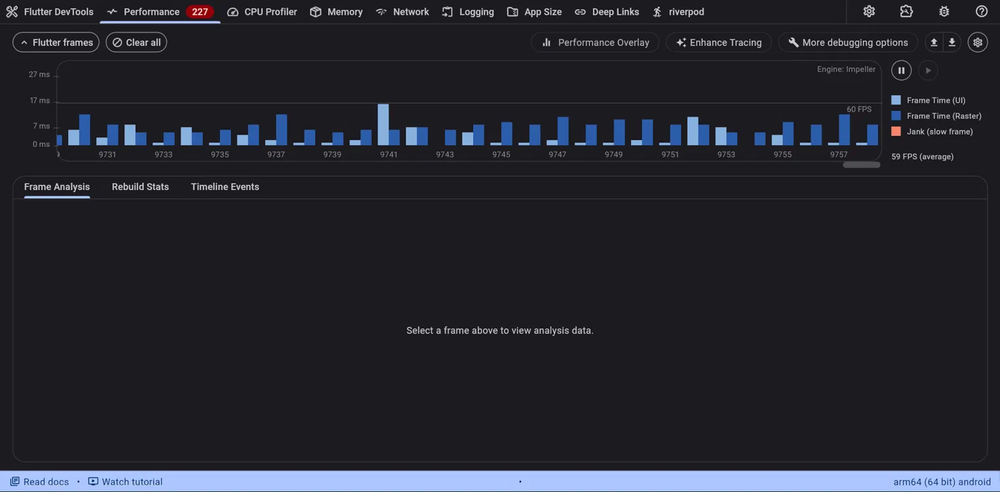
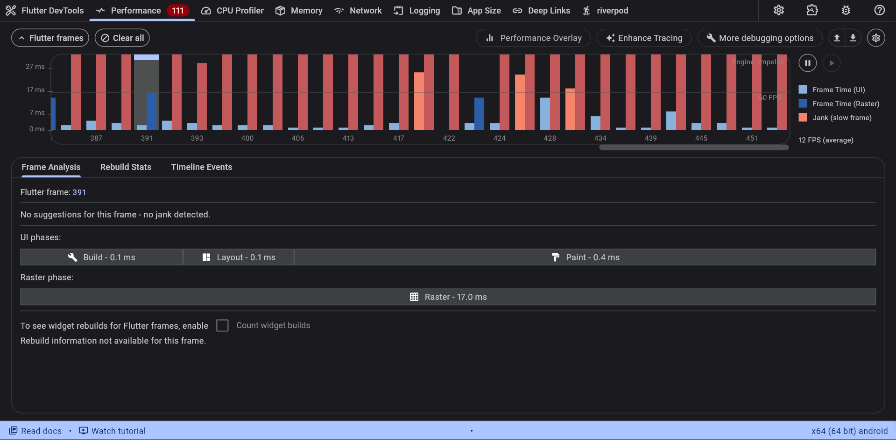
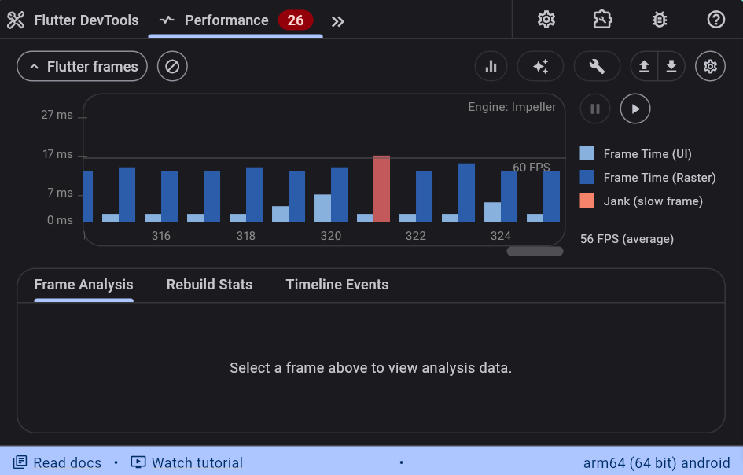
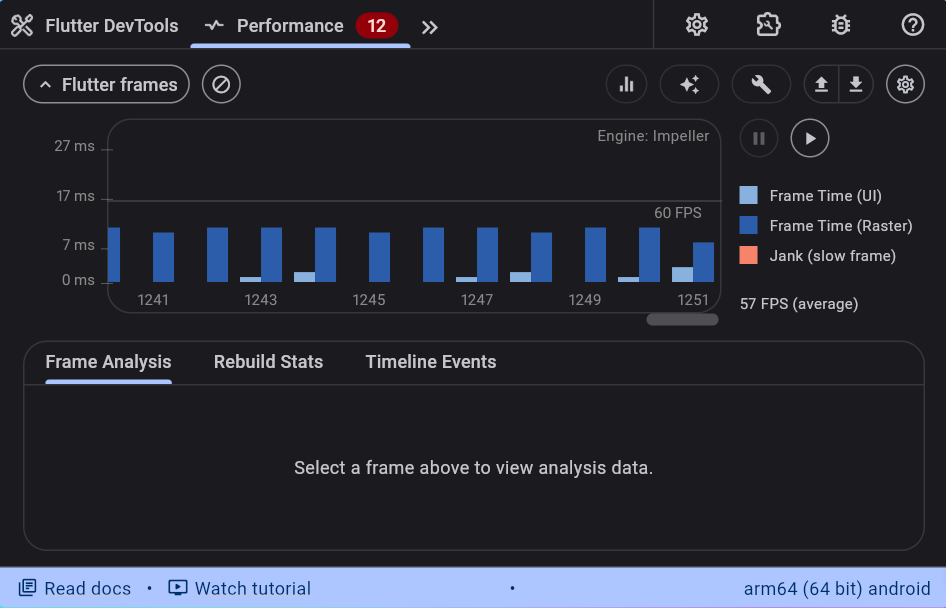
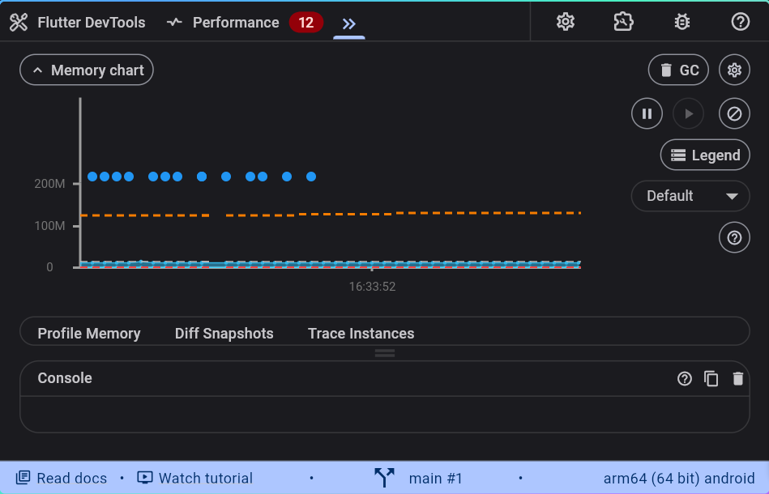
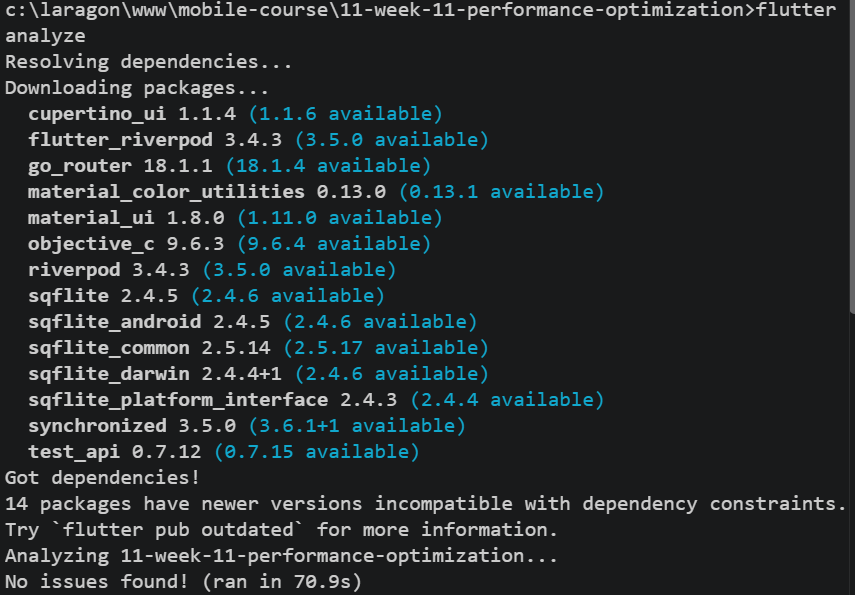
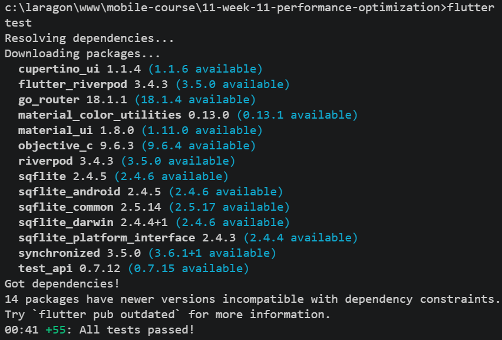

# Laporan Praktikum 11 — Optimasi Performa

| Keterangan | Data |
|---|---|
| Nama | Sileysa Faedatul Nuraini |
| NIM | 244107020231 |
| Mata Kuliah | Pemrograman Mobile |
| Pertemuan | Minggu 11 |

---

# Tujuan

Setelah menyelesaikan codelab ini, mahasiswa mampu:

1. menggunakan Flutter DevTools untuk melakukan profiling CPU dan memori;
2. mengidentifikasi serta mengurangi widget rebuild yang tidak diperlukan;
3. menerapkan lazy loading, pagination, dan optimasi gambar;
4. mengoptimalkan jaringan dengan menerapkan caching dan strategi offline-first;
5. memperbaiki bottleneck performa pada aplikasi yang sudah ada.

Project yang dioptimasi adalah salinan project Minggu 10 (`10-week-10-ai-feature-integration`) dengan fitur auth, chat, notes (SQLite), dan posts (cache offline). Stack: Flutter 3.47.5, Dart 3.13.4, Riverpod 3, go_router, sqflite, Dio.

Pengerjaan difokuskan pada profiling CPU dan memori serta pengurangan rebuild pada fitur **Catatan Offline** (tujuan 1, 2, dan 5). Daftar pada Notes dan Posts sudah memakai `ListView.builder` sehingga lazy loading sudah terpenuhi tanpa perubahan.

Laporan lengkap ada di [docs/performance-report.md](docs/performance-report.md) dan daftar temuan di [docs/performance-findings.md](docs/performance-findings.md).

# Praktikum 1 — Baseline Profiling

**Lingkungan.** HP Android asli (arm64), mode `flutter run --profile`, Flutter DevTools tab Performance. Rekaman pertama sempat dibuat di emulator x64 dan hasilnya 10–12 FPS dengan waktu raster tinggi (sekitar 17 ms) sementara fase Build hanya 0,1 ms. Itu khas emulator tanpa akselerasi GPU, sehingga rekaman emulator **tidak dipakai** sebagai baseline.

**Data uji.** Tombol seed sementara di AppBar halaman Notes menambahkan 500 catatan dummy agar beban terukur. Tombol ini hanya untuk profiling.

**Skenario.** Buka Posts, scroll cepat, buka Notes, scroll cepat, ketik di kolom pencarian, buka detail catatan, kembali. Untuk pengukuran yang lebih terkontrol dipakai skrip tetap: *Clear all* → ketik `catatan` → tekan X → ketik `uji 1` → tekan X → ulangi 3 putaran → pause.

| Observasi data asli | Baseline sebelum optimasi |
|---|---|
|  |  |

| Rekaman | Jank | FPS rata-rata | Catatan |
|---|---|---|---|
| Observasi data asli | tidak ada pada jendela yang terlihat | 59 | Aplikasi sudah lancar tanpa data uji besar |
| Skenario pencarian, kode asli, 500 catatan | 53 | 51 | Contoh frame: UI 18,4 ms, raster 7,7 ms |
| Frame jank pada rekaman panjang | – | 57 | Build 13,5 ms, Layout 10,6 ms, Paint 3,2 ms |

Badge jank pada rekaman panjang bersifat kumulatif sejak aplikasi dibuka, sehingga tidak dibandingkan langsung dengan rekaman pendek.

# Praktikum 2 — Identifikasi Masalah

Temuan lengkap dengan bukti ada di `docs/performance-findings.md`.

| # | Temuan | Status |
|---|---|---|
| 1 | `setState` di setiap ketikan pencarian membangun ulang seluruh `NotesPage` | Didukung data: jank dominan di fase UI saat mengetik |
| 2 | Widget `Chip` di setiap `NoteTile` untuk catatan belum tersinkron | Dugaan, tidak terbukti oleh pengukuran |
| 3 | Daftar dibangun ulang di setiap ketikan walau pengguna masih mengetik | Dugaan, dampak kecil |
| 4 | Lonjakan fase Build berkala (sekitar 14–35 ms) | Penyebab widget belum teridentifikasi |

`SearchNotes` (filter `toLowerCase().contains`) diperiksa dan sengaja **tidak dioptimasi** karena biayanya kecil untuk 500 item.

# Praktikum 3 — Optimasi

| # | Optimasi | File |
|---|---|---|
| 1 | Pencarian tanpa `setState`: daftar dibungkus `ValueListenableBuilder`, kolom pencarian diekstrak menjadi `_SearchField` yang mendengarkan controller sendiri | `presentation/pages/notes_page.dart` |
| 2 | Penanda "belum tersinkron" memakai `Icon` ringan (dengan `Semantics`) pengganti `Chip` | `presentation/widgets/note_tile.dart` |
| 3 | Debounce pencarian 250 ms lewat `Timer` dan `ValueNotifier<String>`; tombol X langsung mengosongkan | `presentation/pages/notes_page.dart` |

Trade-off: optimasi 2 mengubah label teks menjadi ikon, dan optimasi 3 menunda hasil pencarian sekitar seperempat detik.

**Dampak pada tes.** Setelah debounce, tiga tes widget pencarian di `test/notes_page_search_test.dart` gagal karena memeriksa hasil segera setelah `enterText`. Tes disesuaikan dengan menambahkan `await tester.pump(const Duration(milliseconds: 300));` setelah mengetik.

# Praktikum 4 — Verifikasi Profiling

| Sesudah optimasi (rekaman 1) | Sesudah optimasi (rekaman 2) |
|---|---|
|  |  |

| Kondisi kode | Jank | FPS rata-rata | Bukti |
|---|---|---|---|
| Sebelum optimasi (skenario pencarian, kode asli) | 53 | 51 | `screenshots/before-profile.png` |
| Kode akhir, rekaman 1 | 26 | 56 | `screenshots/after-profile.png` |
| Kode akhir, rekaman 2 | 12 | 57 | `screenshots/after-profile-run-2.png` |

**Pembacaan hasil.** Jank turun dari 53 menjadi 12–26 dan FPS naik dari 51 menjadi 56–57. Namun kode akhir yang sama menghasilkan 26 dan 12 jank pada dua rekaman, sehingga variasi antar-rekaman besar. Rekaman awal juga tidak memakai skrip tetap yang sama, dan uji A/B terkontrol terhadap versi asli belum dilakukan. Karena itu angka ini bersifat indikatif dan belum membuktikan dampak masing-masing optimasi.

# Praktikum 5 — Memory Profiling



Langkah: heap snapshot di halaman daftar, masuk dan keluar halaman detail 5 kali, snapshot kedua, lalu dibandingkan.

Hasil: Screenshot grafik Memory tersedia, tetapi belum memperlihatkan perbandingan dua heap snapshot (sebelum dan sesudah masuk-keluar halaman detail 5 kali) maupun angka sebelum/sesudah. Karena itu belum ada dasar untuk menyimpulkan ada atau tidaknya memory leak.

# Refactoring, testing, dan error umum

| Analyze | Test |
|---|---|
|  |  |

```
flutter analyze   -> No issues found!
flutter test      -> All tests passed!"
```

# Refleksi

### 1. Optimasi mana yang memberikan dampak terbesar dan mengapa?

Optimasi 1 (pencarian tanpa `setState`). Rekaman menunjukkan jank saat mengetik berasal dari fase UI (Build), dan optimasi ini mengurangi pekerjaan yang dibangun ulang di setiap ketikan. Jumlah jank turun dari 53 ke kisaran 24–28, walau perbandingannya belum terkontrol penuh.

### 2. Bagaimana memverifikasi bahwa optimasi benar-benar bekerja (bukan placebo)?

Dengan profiling sebelum dan sesudah memakai skenario yang sama, dan mengulang rekaman. Pengulangan menunjukkan variasi antar-rekaman sekitar ±5 jank (kode yang sama menghasilkan 18 dan 26), jadi satu rekaman saja tidak cukup. Hipotesis `Chip` yang berat justru **tidak terbukti** oleh data, sehingga optimasi 2 dicatat tanpa klaim perbaikan.

### 3. Trade-off apa yang dihadapi?

Debounce menunda hasil pencarian dan membuat tiga tes yang ada harus disesuaikan. Mengganti `Chip` dengan ikon mengubah tampilan. `ValueListenableBuilder` membuat alur kode sedikit lebih kompleks dibanding `setState` biasa.

### 4. Kapan optimasi prematur sebaiknya dihindari?

Ketika bagian itu bukan sumber masalah yang terukur. Contohnya fungsi pencarian `SearchNotes` sengaja tidak dioptimasi karena murah untuk 500 item. Dengan data biasa aplikasi sudah sekitar 59 FPS, sehingga sebagian optimasi hanya terukur pada data uji yang berat.

---
