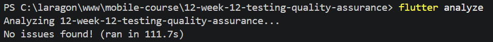
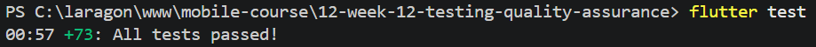
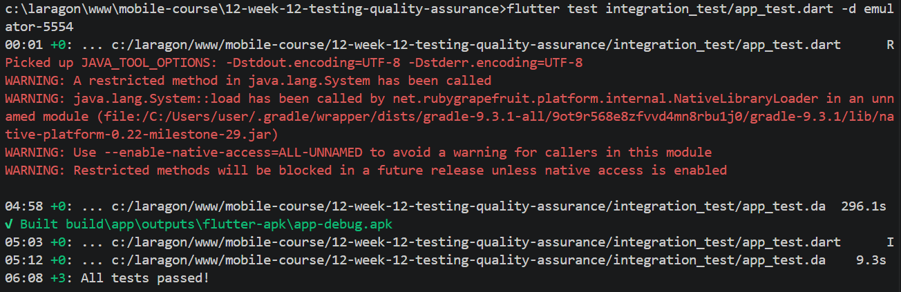
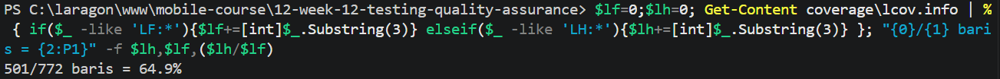

# Laporan Praktikum 12 — Pengujian dan Jaminan Kualitas

| Keterangan | Data |
|---|---|
| Nama | Sileysa Faedatul Nuraini |
| NIM | 244107020231 |
| Mata Kuliah | Pemrograman Mobile |
| Pertemuan | Minggu 12 |

---

# Tujuan

Setelah menyelesaikan codelab ini, mahasiswa mampu:

1. Menentukan bagian aplikasi yang perlu diuji dengan pengujian unit, widget, atau integrasi;
2. Menulis pengujian unit untuk logika dan kasus tepi;
3. Menguji tampilan serta interaksi widget Flutter;
4. Memisahkan dependensi agar kode mudah diuji, termasuk dengan fake repository;
5. Menjalankan pengujian integrasi dan menggunakan cakupan kode sebagai bahan evaluasi.

Project yang diuji adalah salinan project Minggu 11 (`11-week-11-performance-optimization`) di folder `12-week-12-testing-quality-assurance`, dengan fitur auth, chat, notes (SQLite), dan posts (cache offline). Stack: Flutter 3.47.5, Dart 3.13.4, Riverpod 3, go_router, sqflite, Dio. Nama package: `week7_clean_architecture`.

Pengujian difokuskan pada fitur **Catatan Offline** (Notes), yaitu fitur yang dioptimasi pada Minggu 11. Test pencarian dan debounce dari Minggu 11 dipertahankan sebagai test regresi.

# Persiapan dan Baseline

Folder Minggu 11 disalin menjadi `12-week-12-testing-quality-assurance` pada branch `feature/week-12-testing`. Paket `integration_test` ditambahkan ke `dev_dependencies` pada `pubspec.yaml`.

Kondisi awal sebelum menambah test Minggu 12:

| Pemeriksaan | Hasil |
|---|---|
| `flutter analyze` | No issues found |
| `flutter test` | 55 test lulus |

Test yang sudah ada dari minggu sebelumnya: `add_note`, `get_notes`, `search_notes`, `note`, `login`, `chat_*`, `get_posts`, `post_model`, `core_format`, dan `notes_page_search`, beserta `test/fakes/fake_note_repository.dart` dan `fake_chat_repository.dart`.

# Rancangan Skenario

| No | Jenis | Skenario | Kategori |
|----|-------|----------|----------|
| 1 | Unit | AddNote menolak judul kosong dan judul whitespace saja | Gagal / tepi |
| 2 | Unit | AddNote men-trim judul yang valid | Sukses |
| 3 | Unit | DeleteNote menghapus catatan yang dipilih | Sukses |
| 4 | Unit | DeleteNote mengembalikan failure dan tidak menghapus apa pun | Gagal |
| 5 | Unit | SyncNotes tanpa catatan dirty tidak memanggil `markAllSynced` | Tepi |
| 6 | Unit | SyncNotes menyinkronkan catatan dirty dan melaporkan jumlahnya | Sukses |
| 7 | Unit | SyncNotes berhenti jika `countDirty` gagal | Gagal |
| 8 | Unit | SyncNotes mengembalikan failure jika `markAllSynced` gagal | Gagal |
| 9 | Widget | Halaman Notes: keadaan kosong, daftar, error muat, jumlah belum tersinkron | Sukses / gagal |
| 10 | Widget | Tambah catatan: judul kosong ditolak, judul valid tersimpan (di-trim), batal | Sukses / gagal / tepi |
| 11 | Widget | Hapus catatan: berhasil dan gagal (snackbar) | Sukses / gagal |
| 12 | Widget | Sinkronisasi: tombol nonaktif, berhasil, gagal | Sukses / tepi / gagal |
| 13 | Widget | Pencarian: filter, debounce 250 ms, tombol hapus pencarian | Sukses / tepi |
| 14 | Integrasi | Tambah catatan lalu muncul di daftar | Sukses |
| 15 | Integrasi | Judul kosong ditolak dengan pesan error | Gagal |
| 16 | Integrasi | Tambah dua catatan lalu cari | Sukses |

# Praktikum 1 — Unit Test

Unit test menguji use case tanpa UI. Repository diganti `FakeNoteRepository`.

| File | Isi | Jumlah test |
|---|---|---|
| `test/add_note_test.dart` | Judul kosong, trim, empat jenis whitespace | 6 |
| `test/delete_note_test.dart` | Hapus sukses, hapus gagal | 2 |
| `test/sync_notes_test.dart` | Tanpa dirty, sukses, gagal di `countDirty`, gagal di `markAllSynced` | 4 |

Catatan: `SyncNotes` memiliki `Future.delayed` 1 detik, sehingga test sukses sinkronisasi benar-benar menunggu 1 detik pada unit test.

# Praktikum 2 — Fake Repository

`test/fakes/fake_note_repository.dart` diperbarui agar menyimpan state dan bisa dipaksa gagal pada titik tertentu:

| Perubahan | Alasan |
|---|---|
| `notes` disalin menjadi daftar yang bisa diubah; `addNote` dan `deleteNote` benar-benar mengubah daftar | Widget test dapat memeriksa hasil aksi |
| `failure` membuat semua operasi gagal | Menguji error muat data |
| `deleteFailure` hanya membuat `deleteNote` gagal | Menguji jalur hapus gagal |
| `markSyncedFailure` hanya membuat `markAllSynced` gagal | Menguji dua titik gagal berbeda pada `SyncNotes` |
| `markSyncedCalls` menghitung pemanggilan `markAllSynced` | Memastikan jalur lewat tidak memanggilnya |

Fake duplikat yang sebelumnya didefinisikan sendiri di `notes_page_search_test.dart` dihapus dan diganti fake bersama. Seluruh test lama tetap lulus setelah perubahan ini.

# Praktikum 3 — Widget Test

Repository diganti lewat `ProviderScope(overrides: [noteRepositoryProvider.overrideWithValue(...)])`.

| File | Isi | Jumlah test |
|---|---|---|
| `test/notes_page_test.dart` | Tampilan awal (4), tambah catatan (3), hapus (2), sinkronisasi (3) | 12 |
| `test/notes_page_search_test.dart` | Pencarian, debounce, tombol hapus pencarian (dari Minggu 11) | 5 |

Teknik yang dipakai:

- Debounce pencarian 250 ms dilewati dengan `tester.pump(const Duration(milliseconds: 250))`, bukan `Future.delayed`.
- Delay sinkronisasi 1 detik dilewati dengan `tester.pump(const Duration(seconds: 2))`.
- Pesan validasi dicek persis: `Judul tidak boleh kosong`.
- Error muat memakai `LocalFailure`, sedangkan error validasi memakai `ValidationFailure`.

# Praktikum 4 — Integration Test

File: `integration_test/app_test.dart`, dijalankan di emulator:

```
flutter test integration_test/app_test.dart -d emulator-5554
```

Hasil: **3 test lulus** (`+3: All tests passed!`). Build pertama memakan waktu sekitar 296 detik karena Gradle membangun APK debug.

Keputusan desain:

- Integration test memakai **fake repository**, bukan SQLite sungguhan, agar hasil stabil dan tidak bergantung pada data yang tersisa atau jaringan.
- Test menjalankan `NotesPage` saja, bukan `Week7App` utuh. `Week7HomePage` memakai `IndexedStack` yang membangun ketiga halaman (Notes, Posts, Chat) sekaligus, sehingga `PostsPage` dan `ChatScreen` ikut memanggil API dan database sungguhan.

# Praktikum 5 — Cakupan Kode

Perintah: `flutter test --coverage`, lalu dihitung dari `coverage/lcov.info`.

| Kondisi | Jumlah test | Cakupan baris |
|---|---|---|
| Sebelum Minggu 12 (baseline) | 55 | belum diukur |
| Setelah widget test Notes | 62 | 60,6% (468/772) |
| Akhir Minggu 12 | 73 | **64,9% (501/772)** |

Perubahan pada file Notes:

| File | Sebelum | Sesudah |
|---|---|---|
| `delete_note.dart` | 0% | 100% |
| `sync_notes.dart` | 0% | 100% |
| `notes_page.dart` | 84% | 95% |
| `notes_providers.dart` | 71% | 94% |

# Hasil Pemeriksaan Akhir

| Analyze | Test |
|---|---|
|  |  |

| Integration test | Cakupan |
|---|---|
|  |  |

```
flutter analyze                    -> No issues found!
flutter test                       -> +73: All tests passed!
flutter test integration_test/...  -> +3: All tests passed!
flutter test --coverage            -> 501/772 baris = 64,9%
```

# Refleksi

### 1. Bug apa yang paling mungkin terlewat tanpa test ini?

Regresi diam-diam pada fitur yang sudah ada. Setelah optimasi Minggu 11, pencarian memakai debounce 250 ms dan `ValueListenableBuilder`; tanpa test, perubahan kecil pada alur ini bisa merusak pencarian atau tombol hapus pencarian tanpa disadari. Validasi judul juga rawan: tanpa `trim()`, judul berisi spasi saja lolos, dan hal ini kini dijaga oleh test whitespace. Selain itu, jalur gagal seperti hapus gagal atau sinkronisasi gagal hampir tidak pernah muncul saat dicoba manual, tetapi kini terverifikasi.

### 2. Bagian mana yang perlu fake, dan mengapa membuat test lebih konsisten?

Repository Notes, karena aslinya memakai SQLite dan status sinkronisasi yang bergantung pada data tersisa di perangkat. Dengan `FakeNoteRepository`, input dan hasil selalu sama setiap dijalankan, dan kegagalan bisa dipancing sesuai keinginan (`failure`, `deleteFailure`, `markSyncedFailure`). Dua titik gagal berbeda pada `SyncNotes` hampir mustahil dipancing pada aplikasi sungguhan, tetapi mudah dengan fake.

### 3. Apa beda nilai widget test dan integration test untuk fitur ini?

Widget test cepat (seluruh 73 test selesai dalam kisaran satu menit) dan fokus pada satu halaman sehingga cocok untuk memeriksa banyak kondisi: kosong, error, validasi, snackbar. Integration test lambat (build pertama sekitar 5 menit) tetapi berjalan di perangkat nyata dan memeriksa alur dari awal sampai akhir, misalnya tambah lalu cari catatan. Widget test cocok untuk cakupan lebar, integration test untuk keyakinan bahwa alur utama benar-benar bekerja di perangkat.

---