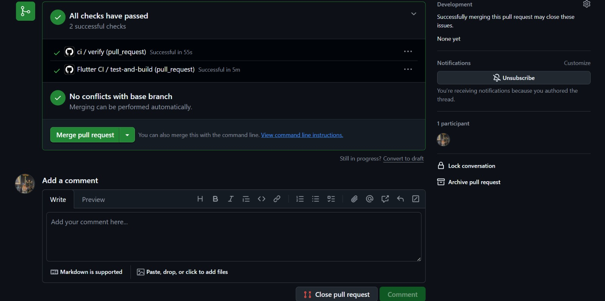
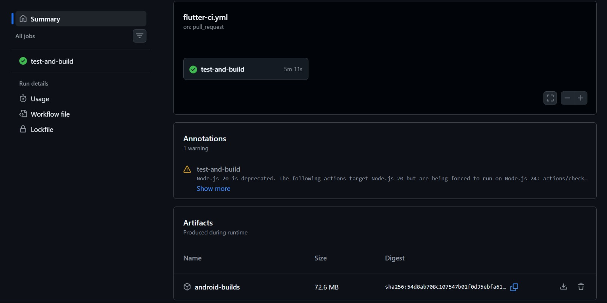

# Laporan Praktikum 13 — CI/CD dan Otomatisasi

| Keterangan | Data |
| --- | --- |
| Nama | Sileysa Faedatul Nuraini |
| NIM | 244107020231 |
| Mata Kuliah | Pemrograman Mobile |
| Pertemuan | Minggu 13 |

---

# Tujuan

Setelah menyelesaikan codelab ini, mahasiswa mampu:

1. Menjelaskan alur CI/CD dari commit hingga artefak aplikasi;
2. Membuat workflow untuk format, analisis, test, dan build Android;
3. Menyimpan APK/AAB sebagai artefak yang dapat ditinjau;
4. Menggunakan versioning dan memahami batasan penyimpanan secret.

Project yang diperiksa adalah salinan project Minggu 12 (`12-week-12-testing-quality-assurance`) di folder `13-week-13-ci-cd-automation`, dengan fitur auth, chat, notes (SQLite), dan posts (cache offline). Stack: Flutter 3.47.5, Dart 3.13.4, Riverpod 3, go\_router, sqflite, Dio. Nama package: `week7_clean_architecture`. Pipeline dijalankan dengan GitHub Actions.

# Persiapan dan Baseline

Repository `mobile-course` berisi satu folder per minggu. Karena itu file workflow diletakkan di root repository (`.github/workflows/flutter-ci.yml`) dan semua perintah Flutter dijalankan di dalam folder project memakai `working-directory`.

Repository sudah memiliki workflow lama `ci.yml` (nama `ci`, pemicu `pull_request`) yang memeriksa project Minggu 7 (`07-week-7-clean-architecture`). Workflow lama tidak diubah. Workflow baru dibuat terpisah dengan nama **Flutter CI**, sehingga keduanya berjalan sendiri-sendiri.

Pemeriksaan lokal pada folder project sebelum workflow dijalankan:

| Pemeriksaan | Perintah | Hasil |
| --- | --- | --- |
| Format | `dart format --output=none --set-exit-if-changed lib test` | 61 file, 0 berubah |
| Analisis | `flutter analyze --fatal-infos` | No issues found |
| Test | `flutter test` | 73 test lulus |

Folder Minggu 13 dibuat dengan menyalin project Minggu 12 memakai `robocopy`, dengan mengecualikan `build`, `.dart_tool`, `.idea`, `.gradle`, `local.properties`, `key.properties`, `*.jks`, `*.keystore`, dan `README.md`. Pengecualian ini mencegah hasil build dan file rahasia ikut masuk ke repository.

# Rancangan Pipeline

| No | Tahap | Perintah | Tujuan |
| --- | --- | --- | --- |
| 1 | Checkout | `actions/checkout@v4` | Mengambil source code ke runner |
| 2 | Siapkan Flutter | `subosito/flutter-action@v2` (versi 3.47.5, cache aktif) | Versi SDK sama dengan lokal |
| 3 | Dependensi | `flutter pub get` | Mengunduh paket |
| 4 | Format | `dart format --output=none --set-exit-if-changed lib test` | Gaya kode konsisten |
| 5 | Analisis statis | `flutter analyze --fatal-infos` | Menangkap masalah sebelum merge |
| 6 | Test | `flutter test --coverage` | Memastikan perilaku tidak rusak |
| 7 | Build APK | `flutter build apk --release` | Berkas untuk instalasi dan uji internal |
| 8 | Build AAB | `flutter build appbundle --release` | Format distribusi Google Play |
| 9 | Artefak | `actions/upload-artifact@v4` | Menyimpan APK dan AAB selama 7 hari |

Jika salah satu tahap gagal, job berhenti dan tahap sesudahnya tidak dijalankan.

# Praktikum 1 — Workflow CI

File `.github/workflows/flutter-ci.yml`:

```yaml
name: Flutter CI

on:
  push:
    branches: [main, develop]
  pull_request:
    branches: [main, develop]
  workflow_dispatch:

permissions:
  contents: read

concurrency:
  group: ${{ github.workflow }}-${{ github.ref }}
  cancel-in-progress: true

jobs:
  test-and-build:
    runs-on: ubuntu-latest
    defaults:
      run:
        working-directory: 13-week-13-ci-cd-automation
    steps:
      - uses: actions/checkout@v4
      - uses: subosito/flutter-action@v2
        with:
          channel: stable
          flutter-version: '3.47.5'
          cache: true
      - run: flutter pub get
      - run: dart format --output=none --set-exit-if-changed lib test
      - run: flutter analyze --fatal-infos
      - run: flutter test --coverage
      - run: flutter build apk --release
      - run: flutter build appbundle --release
      - uses: actions/upload-artifact@v4
        with:
          name: android-builds
          path: |
            13-week-13-ci-cd-automation/build/app/outputs/flutter-apk/app-release.apk
            13-week-13-ci-cd-automation/build/app/outputs/bundle/release/app-release.aab
          if-no-files-found: error
          retention-days: 7
```

Penyesuaian dari contoh pada jobsheet:

| Penyesuaian | Alasan |
| --- | --- |
| `working-directory` dan path artefak mengarah ke folder project | Repository berisi banyak project, sehingga root repository bukan root project Flutter |
| Versi Flutter dikunci ke 3.47.5 dan `cache: true` | Hasil di GitHub sama dengan lokal dan build berikutnya lebih cepat |
| Format hanya `lib test` | `dart format .` ikut memindai folder `build/` dan gagal dengan `PathNotFoundException` |
| Branch `develop` ditambahkan pada `push` dan `pull_request` | Pull request diarahkan ke `develop`, sehingga workflow tidak terpicu jika hanya `main` |
| `permissions: contents: read` | Izin minimum karena job hanya membaca kode |

# Praktikum 2 — Pemeriksaan Lokal

Sebelum push, tiga pemeriksaan yang sama dengan workflow dijalankan di lokal. Hasil awal menunjukkan dua temuan:

1. `dart format .` gagal dengan `PathNotFoundException` pada folder `build/flutter_secure_storage/...`. Perintah dipersempit menjadi `dart format ... lib test`.
2. Setelah dipersempit, 21 file (dari 61) dilaporkan berubah, baik di `lib` maupun `test`. File dirapikan dengan `dart format lib test` dan di-commit terpisah (`style: format Dart code with dart format`, 21 file, 86 baris ditambah, 73 dihapus). Logika kode tidak berubah dan seluruh test tetap lulus.

Peringatan Git `LF will be replaced by CRLF` yang muncul saat `git add` hanya informasi konversi akhir baris di Windows dan tidak memengaruhi hasil.

# Praktikum 3 — Build APK/AAB dan Artefak

Langkah build dan unggah artefak ditambahkan pada job yang sama setelah test lulus. APK praktis untuk instalasi dan uji internal, AAB adalah format distribusi untuk alur Google Play. Artefak `android-builds` memuat `app-release.apk` dan `app-release.aab`, disimpan 7 hari, dan `if-no-files-found: error` membuat job gagal jika berkas tidak ditemukan sehingga kegagalan tidak tersembunyi.

Build yang sukses belum berarti siap dipublikasikan. Signing produksi, konfigurasi aplikasi, izin, dan pengujian di perangkat tetap perlu ditinjau, dan workflow ini tidak mengunggah aplikasi ke Play Store.

# Praktikum 4 — Versioning dan Rahasia

Versi aplikasi berada di `pubspec.yaml` dengan format `versi+build`, misalnya `1.2.0+15`. Aturan yang dipakai mengikuti semantic versioning: **major** untuk perubahan yang tidak kompatibel, **minor** untuk fitur baru yang kompatibel, dan **patch** untuk perbaikan. Build number dinaikkan untuk setiap unggahan baru. Tag seperti `v1.2.0` dibuat pada commit yang sudah lolos pipeline supaya source, log pipeline, dan artefak dapat dihubungkan.

Prinsip penyimpanan rahasia pada project ini:

| Hal | Perlakuan |
| --- | --- |
| `key.properties`, `*.jks`, `*.keystore`, `local.properties` | Tidak disalin dan tidak di-commit; diabaikan oleh `.gitignore` |
| Material signing produksi | Disimpan di GitHub Actions Secrets, hanya dipakai pada workflow rilis yang dibatasi |
| Nilai `--dart-define` | Bukan rahasia karena dapat diekstrak dari aplikasi |
| Pull request dari fork | Tidak mendapat akses ke Secrets |

# Praktikum 5 — Menjalankan Workflow dan Kendala

Workflow dijalankan melalui pull request dari branch fitur. Riwayat commit pada pull request pertama:

| Commit | Pesan | Status di PR |
| --- | --- | --- |
| `9261299` | style: format Dart code with dart format | — |
| `bc866c2` | ci: add Flutter CI workflow for week 12 project | Centang hijau |
| `e5943bf` | ci: run Flutter CI on develop branch too | Tanda silang merah |
| `b31a435` | build: include android project in version control | Centang hijau |

Kendala yang ditemui dan perbaikannya:

| Gejala | Penyebab | Perbaikan |
| --- | --- | --- |
| `flutter pub get` dan `flutter test` gagal di root repo (`Expected to find project root`, `Test directory not found`) | Perintah dijalankan di root repository, sedangkan project berada di subfolder | Masuk ke folder project; workflow memakai `working-directory` |
| Flutter CI tidak muncul pada daftar pemeriksaan PR (hanya `ci / verify`) | PR diarahkan ke `develop`, sedangkan `on` hanya mencakup `main` | Menambahkan `develop` pada `push` dan `pull_request` |
| Step `flutter build apk --release` gagal: `android/app/build.gradle` tidak ditemukan | Aturan `android/` pada baris 54 `.gitignore` project membuat folder Android tidak pernah ikut ke GitHub | Menghapus baris `android/`, lalu commit folder `android` (18 file konfigurasi dan source, tanpa file rahasia) |
| `dart format .` gagal `PathNotFoundException` | Perintah memindai folder `build/` yang berisi jalur hasil build lama | Memformat hanya `lib` dan `test` |

Setelah perbaikan terakhir, commit `b31a435` lolos. Flutter CI berhasil dalam sekitar 5 menit dan workflow lama `ci / verify` tetap hijau pada pull request yang sama. Pull request kemudian di-merge.

Folder Minggu 13 kemudian dibuat sebagai salinan project dan workflow diarahkan ke folder tersebut. Perubahan workflow terbatas pada tiga tempat: `working-directory` dan dua path pada `upload-artifact`.

# Hasil Pemeriksaan Akhir

Tempel tangkapan layar pada bagian ini (simpan berkasnya di folder `screenshots/`):

| Bukti | Berkas | 
| --- | --- |
| Pull request dan checks |  | 
| Artefak |  | 

```
dart format ... lib test   -> 61 file, 0 berubah
flutter analyze            -> No issues found!
flutter test               -> +73: All tests passed!
Flutter CI                 -> test-and-build berhasil (hijau)
Artefak                    -> android-builds (app-release.apk, app-release.aab)
```

# Dokumentasi Tugas

### Pemeriksaan yang dijalankan

Format (`dart format`, hanya `lib` dan `test`), analisis statis (`flutter analyze --fatal-infos`), 73 test (`flutter test --coverage`), build APK dan AAB, serta unggah artefak. Pengujian integrasi (`integration_test`) tidak dijalankan di pipeline karena memerlukan emulator atau perangkat, dan tetap dijalankan secara manual.

### Risiko keamanan yang masih perlu ditangani

| Risiko | Penanganan yang direncanakan |
| --- | --- |
| Build rilis belum ditandatangani dengan keystore produksi | Simpan keystore dan password di GitHub Actions Secrets; pakai hanya pada workflow rilis yang dibatasi, bukan pada workflow pull request |
| Nilai `--dart-define` dapat diekstrak dari aplikasi | Jangan menaruh credential di sana; letakkan rahasia di sisi server |
| Pull request dari fork tidak mendapat Secrets | Jangan membuat job yang bergantung pada Secrets untuk pull request dari fork |
| Versi action (`checkout@v4`, `flutter-action@v2`, `upload-artifact@v4`) dapat berubah atau memiliki kerentanan | Pantau pembaruan dan pertimbangkan mengunci versi lebih ketat |
| Pipeline belum mengunggah ke Play Store dan belum menguji di perangkat | Uji manual di perangkat, tinjau izin aplikasi, dan lakukan persetujuan sebelum rilis |
| Salah konfigurasi `.gitignore` dapat membuat file penting tidak ikut ke repository, atau file rahasia ikut ter-commit | Periksa `git status` sebelum commit; pertahankan aturan untuk `key.properties`, `*.jks`, `*.keystore`, dan `local.properties` |

# Refleksi

### 1. Masalah apa yang ditemukan otomatis sebelum perubahan di-merge?

Paling berharga adalah kegagalan build yang tidak terlihat di komputer sendiri. Folder `android/` terabaikan oleh `.gitignore`, sehingga build berjalan di laptop tetapi gagal di runner yang bersih karena `android/app/build.gradle` tidak ada. Selain itu, pemeriksaan format menemukan 21 file yang belum mengikuti gaya Dart, dan perintah `dart format .` ternyata ikut memindai folder `build/`. Semua temuan ini tertangkap pada pull request, sebelum masuk ke branch tujuan.

### 2. Informasi apa yang dibutuhkan untuk menyelidiki build yang gagal?

Nama step yang gagal dan pesan error pada log step tersebut, karena dari sana penyebab langsung terlihat (misalnya path file yang tidak ditemukan). Informasi pendukung yang diperlukan adalah branch tujuan pull request, versi Flutter yang dipakai, folder kerja (`working-directory`), dan pembanding dengan kondisi lokal, misalnya hasil `git ls-files` untuk memastikan file benar-benar ada di repository. Riwayat commit dan status per commit juga membantu menunjukkan perubahan mana yang memperbaiki atau merusak.

### 3. Bagian mana yang masih perlu persetujuan atau pemeriksaan manual sebelum rilis?

Penandatanganan rilis dengan keystore produksi dan pengelolaan Secrets, pengujian APK di perangkat nyata, pengujian integrasi di emulator, peninjauan izin aplikasi dan konfigurasi rilis, serta keputusan akhir untuk menerbitkan ke Google Play. Pipeline yang hijau menunjukkan kode lolos pemeriksaan otomatis dan build berhasil, tetapi bukan jaminan aplikasi siap dipublikasikan.

---
