# Laporan Praktikum 14 — Deployment dan Monitoring

| Keterangan | Data |
| --- | --- |
| Nama | Sileysa Faedatul Nuraini |
| NIM | 244107020231 |
| Mata Kuliah | Pemrograman Mobile |
| Pertemuan | Minggu 14 |

---

# Tujuan

Setelah menyelesaikan codelab ini, mahasiswa mampu:

1. Menjelaskan alur kandidat rilis hingga pengujian beta;
2. Menyiapkan versi aplikasi dan Android App Bundle (AAB) untuk pengujian internal;
3. Mengonfigurasi Firebase Crashlytics dan Analytics untuk pengujian;
4. Meninjau sinyal rilis dan menentukan tindak lanjut berdasarkan bukti;
5. Menggunakan AI secara bertanggung jawab saat menganalisis log.

Project yang diperiksa adalah salinan project Minggu 13 di folder `14-week-14-deployment-monitoring` pada branch `feature/week14`, dengan fitur catatan offline (SQLite), posts (REST API), dan asisten AI. Stack: Flutter, Dart 3.13.4, Riverpod 3, go\_router, sqflite, Dio. Application ID: `edu.polinema.week7_clean_architecture`. Distribusi beta memakai Firebase App Distribution, karena akses Play Console tidak digunakan.

# Persiapan dan Baseline

Perangkat dan layanan yang digunakan:

| Kebutuhan | Yang dipakai |
| --- | --- |
| Project Flutter dengan test lulus | Salinan project Minggu 13 (73 test) |
| Project Firebase untuk Android | `week14-deployment-monitoring` (Spark plan) |
| Perangkat uji | HP Android CPH2387, Android 14 |
| Jalur distribusi | Firebase App Distribution (Play Console tidak dipakai) |
| Tester | 2 teman sekelas dengan perangkat berbeda |

Pemeriksaan lokal pada folder project sebelum membuat kandidat rilis:

| Pemeriksaan | Perintah | Hasil |
| --- | --- | --- |
| Format | `dart format --output=none --set-exit-if-changed lib test` | `[ISI jika dijalankan, atau hapus baris ini]` |
| Analisis | `flutter analyze --fatal-infos` | No issues found |
| Test | `flutter test` | 73 test lulus |

Sebelum Firebase dipasang, `pubspec.yaml` belum memiliki baris `version:`. Baris `version: 1.0.0+1` ditambahkan sehingga kandidat rilis memiliki versi dan build number yang jelas.

# Rancangan Alur Rilis Beta

| No | Tahap | Perintah / alat | Tujuan |
| --- | --- | --- | --- |
| 1 | Kandidat rilis | `pubspec.yaml`, commit, tag Git | Versi yang dapat ditelusuri |
| 2 | Pemeriksaan | `flutter analyze`, `flutter test` | Memastikan commit layak dirilis |
| 3 | Build | `flutter build appbundle --release`, `flutter build apk --release` | AAB untuk catatan rilis, APK untuk distribusi |
| 4 | Distribusi | Firebase App Distribution | Mengirim build ke tester terundang |
| 5 | Monitoring | Crashlytics dan Analytics | Menangkap crash dan penggunaan fitur |
| 6 | Verifikasi dan triage | Dashboard Firebase | Meninjau sinyal rilis |
| 7 | Keputusan | `docs/release-report.md` | Melanjutkan atau menahan rilis berdasarkan bukti |

# Praktikum 1 — Kandidat Rilis

Versi aplikasi diatur di `pubspec.yaml`:

```yaml
version: 1.0.0+1
```

`1.0.0` adalah versi aplikasi dan `1` adalah build number yang dinaikkan pada setiap unggahan baru. Pemeriksaan dan build dijalankan pada commit kandidat:

```
flutter pub get
flutter analyze --fatal-infos
flutter test
flutter build appbundle --release
flutter build apk --release
```

| Hasil | Nilai |
| --- | --- |
| `flutter analyze --fatal-infos` | No issues found |
| `flutter test` | 73 test lulus |
| AAB | `build/app/outputs/bundle/release/app-release.aab` (49,4 MB) |
| APK | `build/app/outputs/flutter-apk/app-release.apk` (52,2 MB) |
| Tag | `v1.0.0-beta1` |

Build release masih ditandatangani dengan debug key (`signingConfig = debug`). Ini cukup untuk distribusi uji lewat Firebase App Distribution, tetapi belum layak untuk Play Store. File AAB/APK, keystore, dan kredensial tidak di-commit.

Build AAB menampilkan peringatan `Expected to find fonts for (CupertinoIcons, MaterialIcons)`. Peringatan ini tidak menggagalkan build dan hanya menandakan ada kode yang merujuk `CupertinoIcons` tanpa paket `cupertino_icons`.

# Praktikum 2 — Konfigurasi Crashlytics dan Analytics

### Menghubungkan project ke Firebase

```
npm install -g firebase-tools
firebase login
dart pub global activate flutterfire_cli
flutter pub add firebase_core firebase_crashlytics firebase_analytics
dart pub global run flutterfire_cli:flutterfire configure
```

Pada `flutterfire configure`, project `week14-deployment-monitoring` dipilih dengan platform Android saja. Aplikasi `edu.polinema.week7_clean_architecture` terdaftar otomatis dan file `lib/firebase_options.dart` serta `android/app/google-services.json` terbentuk. FlutterFire juga menambahkan plugin Gradle secara otomatis:

| File | Plugin |
| --- | --- |
| `android/settings.gradle.kts` | `com.google.gms.google-services` 4.4.4 dan `com.google.firebase.crashlytics` 3.0.7 (`apply false`) |
| `android/app/build.gradle.kts` | `com.google.gms.google-services` dan `com.google.firebase.crashlytics` |

### Penanganan error di `main()`

```dart
Future<void> main() async {
  WidgetsFlutterBinding.ensureInitialized();
  await Firebase.initializeApp(
    options: DefaultFirebaseOptions.currentPlatform,
  );

  FlutterError.onError =
      FirebaseCrashlytics.instance.recordFlutterFatalError;

  PlatformDispatcher.instance.onError = (error, stack) {
    FirebaseCrashlytics.instance.recordError(error, stack, fatal: true);
    return true;
  };

  runApp(const ProviderScope(child: Week7App()));
}
```

### Event Analytics non-sensitif dan pemicu uji

File `lib/monitoring.dart` berisi tiga aksi uji:

```dart
class Monitoring {
  static Future<void> logBetaFeedbackSent() async {
    await FirebaseAnalytics.instance.logEvent(
      name: 'beta_feedback_sent',
      parameters: {'screen_name': 'home'},
    );
  }

  static Future<void> recordTestNonFatal() async {
    await FirebaseCrashlytics.instance.recordError(
      Exception('Test non-fatal error week14'),
      StackTrace.current,
      reason: 'Uji Crashlytics (non-fatal)',
      fatal: false,
    );
  }

  static void forceTestCrash() {
    FirebaseCrashlytics.instance.crash();
  }
}
```

Aksi ini dipanggil dari menu uji (tombol kecil di pojok kiri bawah halaman utama pada `routes.dart`). Event hanya memuat nama layar, tanpa isi catatan, email, token, atau pengenal pribadi. Arti event: `beta_feedback_sent` menandai tester memicu aksi uji dari layar utama. Menu uji hanya untuk verifikasi beta dan akan dihapus sebelum rilis ke pengguna umum.

# Praktikum 3 — Distribusi ke Tester

Distribusi memakai Firebase App Distribution dengan APK release.

1. Mengaktifkan App Distribution pada project Firebase.
2. Membuat grup tester `beta-tester` dan menambahkan email dua teman sekelas.
3. Mengunggah `app-release.apk` versi 1.0.0 (1) dan mengisi catatan rilis.
4. Menekan **Distribute**; tester menerima email undangan dan menginstal lewat tautan.

Pengunggahan pertama sempat ditolak (lihat bagian kendala). Setelah APK yang benar diunggah, rilis terdistribusi ke kedua tester.

### Hasil uji tester

| Item | Tester 1 | Tester 2 |
| --- | --- | --- |
| Perangkat | Infinix Hot 50, Android 14 | Redmi Note 14, Android 16 |
| Versi yang diuji | 1.0.0+1 | 1.0.0+1 |
| Waktu instalasi | ± 10 menit (internet lambat) | ± 5 menit |
| Fitur yang dicoba | Seluruh fitur | Seluruh fitur |
| Hasil yang diharapkan | Sesuai harapan | Sesuai harapan |
| Hasil aktual | Lancar, tidak ada masalah | Lancar, tidak ada masalah |
| Langkah reproduksi masalah | Tidak ada | Tidak ada |
| Saran | Tidak ada | Tidak ada |

Umpan balik tester 1 disertai tangkapan layar aplikasi di perangkatnya; umpan balik tester 2 disampaikan lewat teks.

# Praktikum 4 — Verifikasi Telemetry dan Triage

Verifikasi dilakukan pada build mode release di HP uji (CPH2387, Android 14):

```
flutter run --release -d <id-perangkat>
```

Urutan uji: membuka aplikasi dari layar HP, memicu event Analytics dan error non-fatal beberapa kali, lalu memicu crash fatal uji. Aplikasi dibuka kembali setelah crash supaya laporan terkirim. Mode release dipakai karena crash yang dipicu saat debugger terpasang sering tidak terkirim ke Crashlytics.

### Crashlytics

| Jenis | Issue | Waktu | Versi / perangkat |
| --- | --- | --- | --- |
| Fatal | `FirebaseCrashlyticsTestCrash` (dipicu `.crash()`) | 25 Nov 2026, 23:11 | 1.0.0 (1), Android 14, CPH2387 |
| Non-fatal | `Exception: Test non-fatal error week14` | 25 Nov 2026, 23:00 | 1.0.0 (1), Android 14, CPH2387 |

- Stack trace error non-fatal menunjuk ke `monitoring.dart:17` yang dipanggil dari `routes.dart:70`, sehingga sumber error dapat dilacak sampai baris kode.
- Masing-masing issue tercatat 1 event dan 1 pengguna.
- Crash-free users 0% dan crash-free sessions 75% muncul karena crash fatal sengaja dipicu di satu perangkat. Angka ini tidak mencerminkan stabilitas aplikasi yang sebenarnya.

### Analytics

Event `beta_feedback_sent` terbaca di DebugView, dan panel Top Events menampilkan 4 kejadian pada 30 menit terakhir. DebugView diaktifkan dengan:

```
adb shell setprop debug.firebase.analytics.app edu.polinema.week7_clean_architecture
```

parameter `screen_name = home` terlihat di DebugView

### Triage

Data agregat adalah sinyal, bukan bukti tunggal akar masalah. Kedua issue di Crashlytics dipastikan berasal dari menu uji yang sengaja dipicu dengan mencocokkan stack trace ke kode, bukan dari bug aplikasi. Tidak ada laporan masalah fungsional dari tester.

# Praktikum 5 — Kendala yang Ditemui

| Gejala | Penyebab | Perbaikan |
| --- | --- | --- |
| `flutter pub get` gagal: `Expected to find project root in current working directory` | Perintah dijalankan di folder induk, bukan di folder project | Masuk ke folder project terlebih dahulu |
| `pwd` tidak dikenali | Terminal yang dipakai adalah CMD, bukan PowerShell | Memakai `cd` untuk melihat lokasi |
| `firebase` dan `flutterfire` tidak dikenali | Firebase CLI belum terpasang; folder `Pub\Cache\bin` belum ada di PATH | Memasang `firebase-tools` dengan npm dan memanggil FlutterFire lewat `dart pub global run flutterfire_cli:flutterfire configure` |
| Build release tidak punya versi | `pubspec.yaml` belum berisi `version:` | Menambahkan `version: 1.0.0+1` |
| `adb` tidak dikenali | Folder `platform-tools` belum ada di PATH | Memanggil `adb.exe` lewat path lengkap di folder Android SDK |
| Unggahan ke App Distribution ditolak: package `id.capsee.app` tidak cocok | APK yang dipilih berasal dari project lain | Membuild ulang APK dari folder project yang benar dan mengunggah file tersebut; package name tidak diubah |
| Dashboard Crashlytics hanya menunjukkan "waiting for a crash" lalu hanya 0% crash-free | Filter bawaan hanya menampilkan `Crashes` dan crash fatal belum dipicu | Memicu crash uji pada build release lalu mengubah filter event type ke Non-fatals untuk melihat error non-fatal |
| Instalasi di HP tester lama | Pemindaian aplikasi dari luar Play Store dan koneksi internet lambat | Menunggu proses selesai; dicatat sebagai temuan distribusi |
| Tampilan gambar pada laporan rusak | Folder `screenshots` berada di root project, bukan di `docs/` tempat laporan berada | Memindahkan folder ke `docs/screenshots` |

# Hasil Pemeriksaan Akhir

Tangkapan layar (berkas disimpan di folder `screenshots/` di samping laporan ini, yaitu `docs/screenshots/`):

| Bukti | Berkas |
| --- | --- |
| Pemeriksaan lulus | 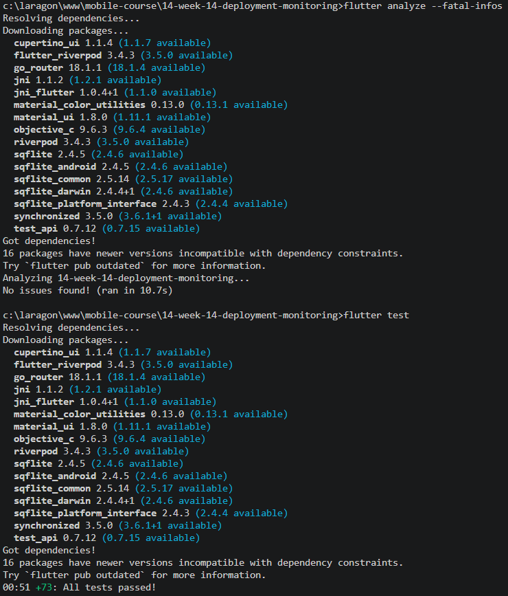 |
| Build AAB | 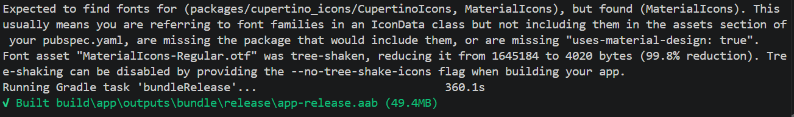 |
| Menu uji monitoring di HP | 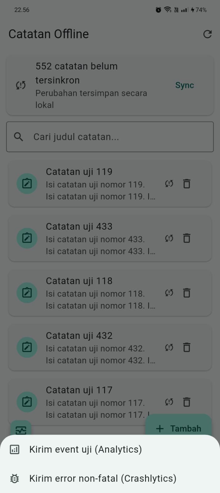 |
| Ringkasan Crashlytics | 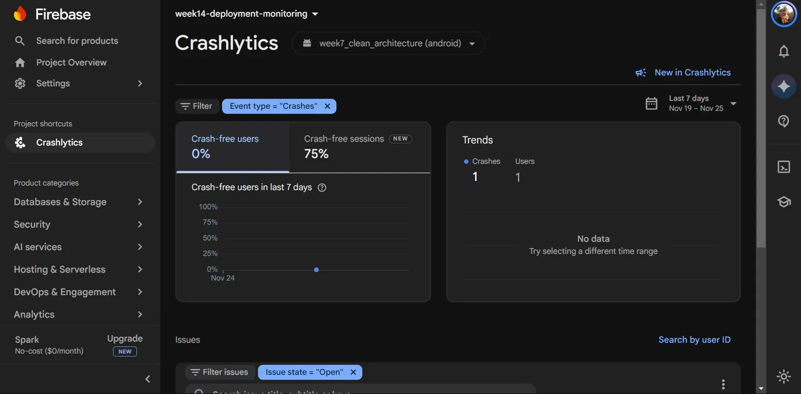 |
| Issue crash fatal | 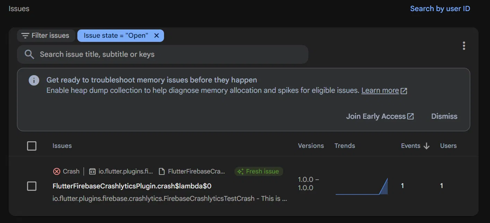 |
| Detail crash fatal | 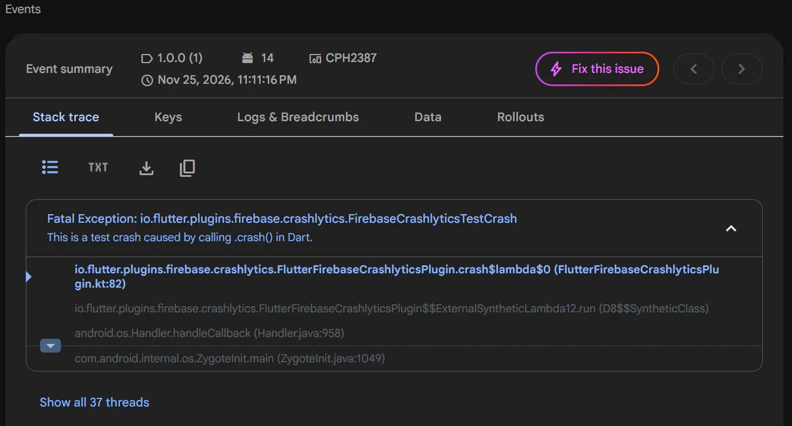 |
| Tren non-fatal | 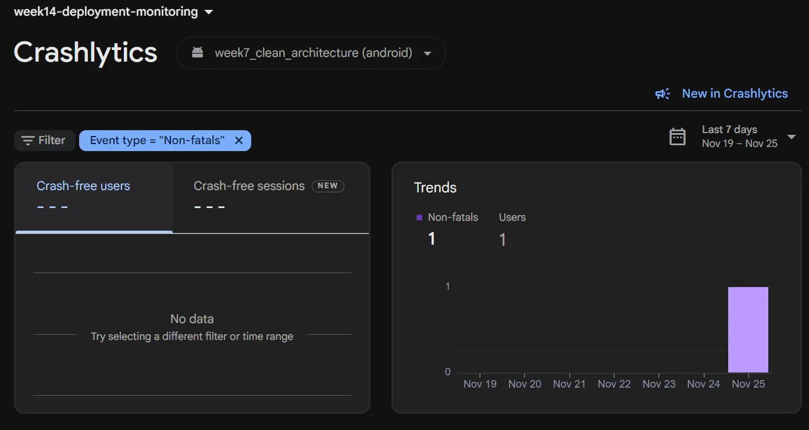 |
| Issue non-fatal | 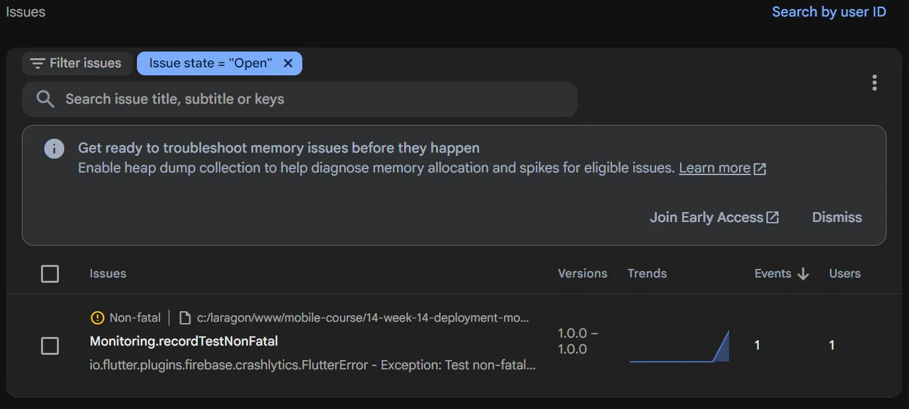 |
| Detail non-fatal | 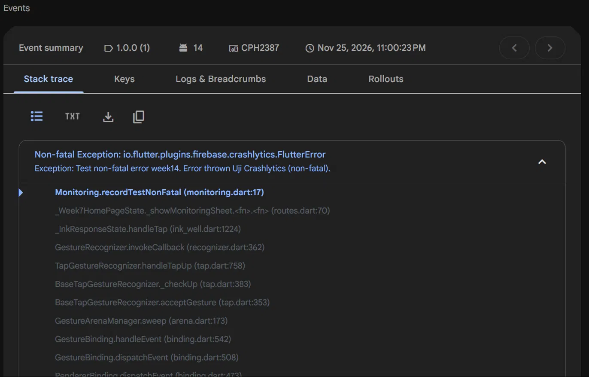 |
| Analytics (DebugView) | 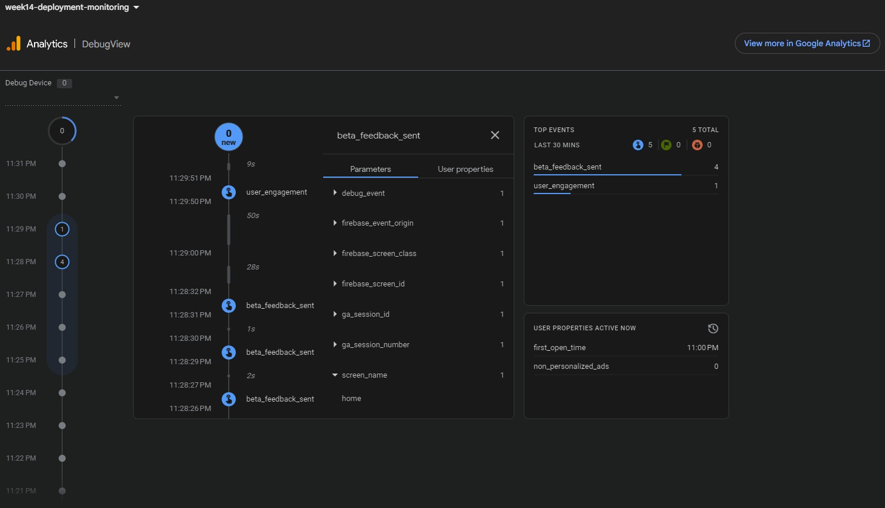 |
| Build APK | 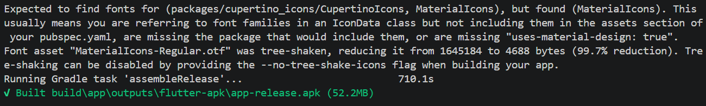 |
| App Distribution | 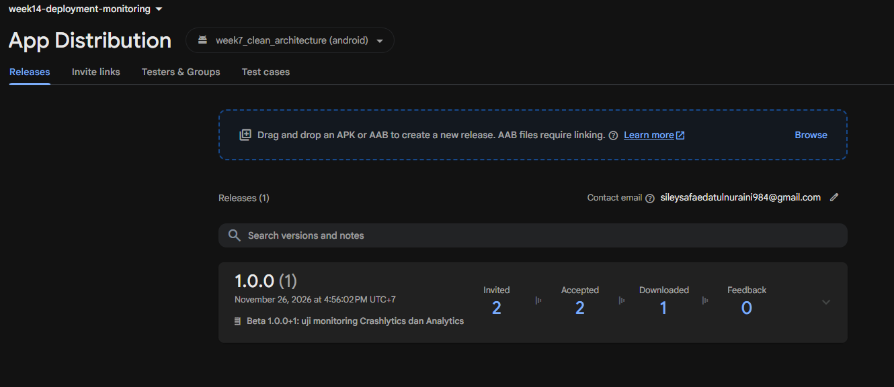 |
| Instalasi di perangkat tester | 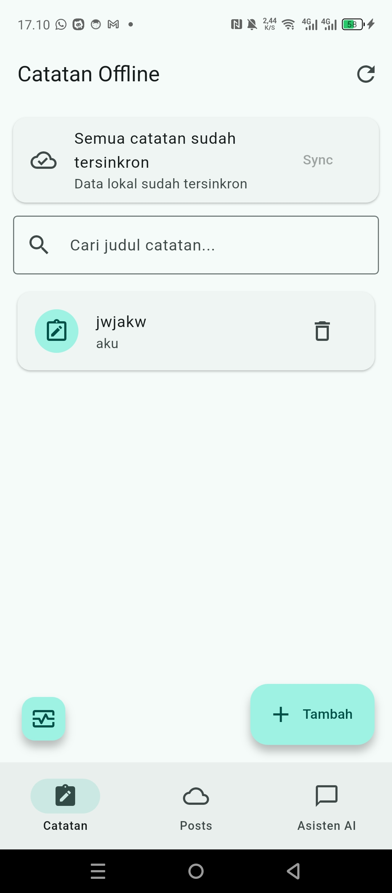 |
| Umpan balik tester 1 | 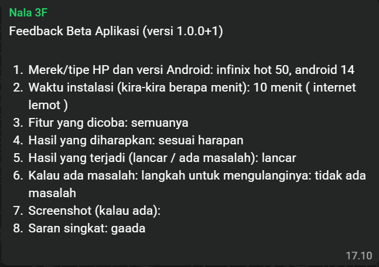 |
| Umpan balik tester 2 | 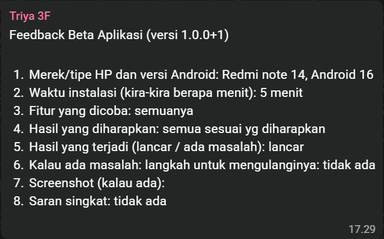 |

```
flutter analyze            -> No issues found!
flutter test               -> +73: All tests passed!
flutter build appbundle    -> app-release.aab (49,4 MB)
flutter build apk          -> app-release.apk (52,2 MB)
App Distribution           -> 1.0.0 (1) terdistribusi ke 2 tester
Crashlytics                -> 1 crash fatal uji + 1 error non-fatal uji tercatat
Analytics                  -> beta_feedback_sent terbaca di DebugView
```

# Dokumentasi Tugas

### Isi `docs/release-report.md`

Laporan rilis beta berisi kandidat rilis, bukti distribusi, hasil uji tester, konfigurasi dan hasil monitoring, temuan dan dampak, keputusan, serta langkah berikutnya.

### Keputusan rilis

Rilis dilanjutkan ke beta terbatas berikutnya, belum ke rilis publik. Seluruh pemeriksaan lulus, kedua tester tidak menemukan masalah, dan monitoring terbukti bekerja. Namun bukti stabilitas masih terbatas: dua tester, dua perangkat, dan pemakaian singkat.

### Risiko yang masih perlu ditangani

| Risiko | Penanganan yang direncanakan |
| --- | --- |
| Menu uji (termasuk crash paksa) masih ada di aplikasi | Hapus atau sembunyikan dari build untuk pengguna sebelum rilis berikutnya |
| Build release memakai debug key | Buat keystore sendiri, simpan di luar repository, dan tandatangani hanya pada build rilis |
| Cakupan tester dan perangkat sempit | Tambah tester dengan merek dan versi Android berbeda, lalu pantau crash-free users beberapa hari |
| Crash-free users saat ini dipengaruhi crash uji sengaja | Hapus data uji dari analisis, atau bandingkan hanya sesi pengguna nyata |
| Data pribadi dapat terkirim ke layanan monitoring | Hanya catat nama layar dan aksi; jangan kirim isi catatan, email, token, atau ID pengguna |
| `google-services.json` dan `firebase_options.dart` ikut di repository | Tanyakan kepada pengajar bila repository publik; keduanya berisi konfigurasi, bukan kata sandi |

# Refleksi

### 1. Bukti apa yang diperlukan sebelum memperluas distribusi beta?

Hasil pemeriksaan otomatis yang lulus, tidak ada crash fatal yang penyebabnya belum diketahui, crash-free users yang stabil dari pengguna nyata (bukan crash uji), umpan balik dari beberapa tester dengan perangkat berbeda, serta rencana penanganan temuan. Dua tester dengan hasil lancar belum cukup karena jumlah dan variasi perangkatnya kecil.

### 2. Bagaimana memutuskan menahan atau melanjutkan rilis?

Rilis ditahan bila ada crash pada alur utama, kehilangan data, atau risiko keamanan, lalu dicatat alasan, bukti, dan versi perbaikannya. Rilis dilanjutkan bila temuan hanya kosmetik atau berisiko rendah dan sudah terdokumentasi. Pada rilis ini keputusannya melanjutkan secara terbatas, karena tidak ada masalah nyata yang ditemukan tetapi bukti stabilitas masih sedikit.

### 3. Data apa yang tidak perlu dikirim ke layanan monitoring?

Email, nama, nomor telepon, token atau kata sandi, isi catatan pengguna, ID pengguna yang dapat dikaitkan ke identitas, dan pesan yang diketik ke asisten AI. Event Analytics cukup memuat nama layar atau nama aksi, dan laporan crash tidak boleh memuat kredensial.

---