# Laporan Rilis Beta — Jobsheet 14: Deployment dan Monitoring

| | |
|---|---|
| Nama / NIM | Sileysa Faedatul Nuraini / 244107020231 |
| Aplikasi | Clean Architecture Notes (`week7_clean_architecture`) |
| Application ID | `edu.polinema.week7_clean_architecture` |
| Versi / build | 1.0.0 (build 1) |
| Branch / tag | `feature/week14` / `v1.0.0-beta1` |

---

## 1. Kandidat Rilis

Kandidat rilis beta pertama diberi versi `1.0.0+1` di `pubspec.yaml`. Sebelum dibuild, kode diperiksa dengan perintah berikut.

| Pemeriksaan | Hasil |
|---|---|
| `flutter analyze --fatal-infos` | No issues found |
| `flutter test` | 73 test, semuanya lulus |
| `flutter build appbundle --release` | Berhasil, `app-release.aab` (49,4 MB) |
| `flutter build apk --release` | Berhasil, `app-release.apk` (dipakai untuk distribusi) |

Catatan:
- Build release masih ditandatangani dengan debug key (`signingConfig = debug`). Ini cukup untuk distribusi uji lewat Firebase App Distribution, tetapi **tidak layak untuk rilis publik**.
- File AAB/APK dan keystore tidak di-commit ke repository.

Bukti: 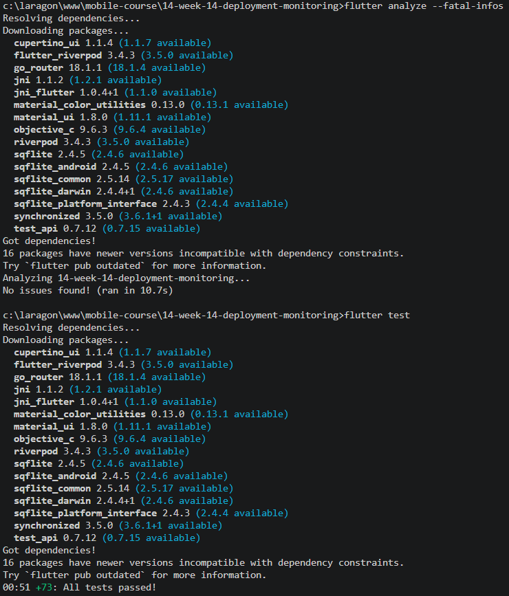 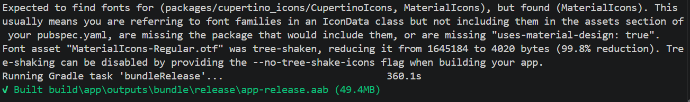 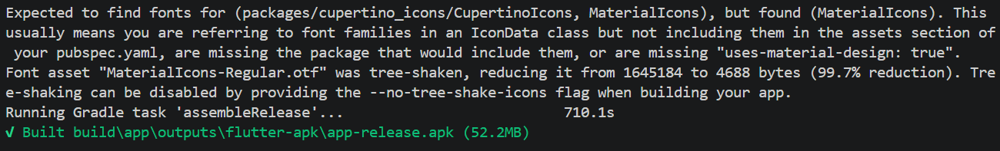

## 2. Distribusi

- **Jalur:** Firebase App Distribution (Play Console tidak dipakai).
- **Berkas yang didistribusikan:** `app-release.apk` versi 1.0.0 (1).
- **Grup tester:** `beta-tester`, berisi 2 tester (teman sekelas).
- **Catatan rilis:** `[ISI: catatan rilis yang diketik saat Distribute]`

Temuan proses distribusi:
- Pengunggahan pertama sempat ditolak karena memilih APK dari project lain (`id.capsee.app`), sedangkan aplikasi Firebase terdaftar sebagai `edu.polinema.week7_clean_architecture`. Masalah diselesaikan dengan membuild ulang APK dari folder project yang benar, tanpa mengubah package name.
- Pada HP tester 1, proses pemindaian dan instalasi memakan waktu sekitar 10 menit karena koneksi internet lambat dan aplikasi dipasang dari luar Play Store. Pada tester 2 prosesnya sekitar 5 menit. Aplikasi terpasang dan berjalan normal di kedua perangkat.

Bukti: 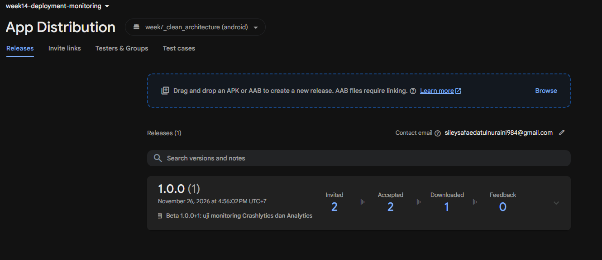 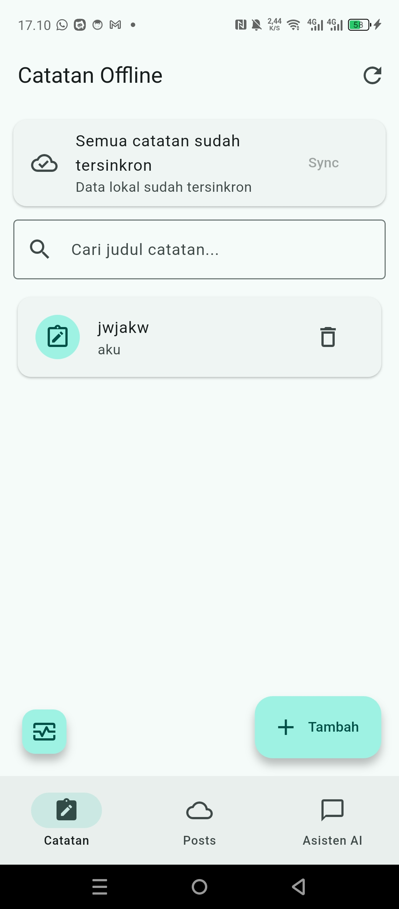

## 3. Hasil Pengujian Tester

| Item | Tester 1 | Tester 2 |
|---|---|---|
| Perangkat | Infinix Hot 50, Android 14 | Redmi Note 14, Android 16 |
| Versi yang diuji | 1.0.0+1 | 1.0.0+1 |
| Waktu instalasi | ± 10 menit (internet lambat) | ± 5 menit |
| Fitur yang dicoba | Seluruh fitur (Catatan, Posts, Asisten AI) | Seluruh fitur |
| Hasil yang diharapkan | Fitur berjalan sesuai harapan | Fitur berjalan sesuai harapan |
| Hasil aktual | Lancar, tidak ada masalah | Lancar, tidak ada masalah |
| Langkah reproduksi masalah | Tidak ada | Tidak ada |
| Saran | Tidak ada | Tidak ada |

Kedua tester melaporkan hasil yang lancar tanpa temuan fungsional. Umpan balik tester 2 disampaikan lewat teks tanpa screenshot.

Keterbatasan: pengujian hanya dilakukan oleh **dua tester pada dua perangkat** (satu Android 14 dan satu Android 16), dengan waktu pemakaian singkat. Cakupan merek perangkat, ukuran layar, dan skenario penggunaan jangka panjang masih sempit.

## 4. Monitoring

### 4.1 Konfigurasi

- Firebase project `week14-deployment-monitoring` (Spark plan), aplikasi Android didaftarkan lewat `flutterfire configure`.
- Paket: `firebase_core`, `firebase_crashlytics`, `firebase_analytics`.
- Plugin Gradle `com.google.gms.google-services` dan `com.google.firebase.crashlytics` aktif.
- `main()` menangkap `FlutterError.onError` dan `PlatformDispatcher.instance.onError` lalu meneruskannya ke Crashlytics.
- Menu uji monitoring (tombol di pojok kiri bawah) berisi tiga aksi: event Analytics, error non-fatal, dan crash fatal uji.

### 4.2 Crashlytics

| Jenis | Issue | Waktu | Versi / perangkat |
|---|---|---|---|
| Fatal | `FirebaseCrashlyticsTestCrash` (dipicu `.crash()`) | 25 Nov 2026, 23:11 | 1.0.0 (1), Android 14, CPH2387 |
| Non-fatal | `Exception: Test non-fatal error week14` | 25 Nov 2026, 23:00 | 1.0.0 (1), Android 14, CPH2387 |

- Stack trace error non-fatal menunjuk ke `monitoring.dart:17` yang dipanggil dari `routes.dart:70`, sehingga sumber error dapat dilacak sampai baris kode.
- Masing-masing issue tercatat 1 event dan 1 pengguna.
- Angka **crash-free users 0%** dan **crash-free sessions 75%** muncul karena crash fatal **sengaja dipicu** dari menu uji pada satu perangkat. Angka ini tidak mencerminkan stabilitas aplikasi yang sebenarnya.

Bukti: 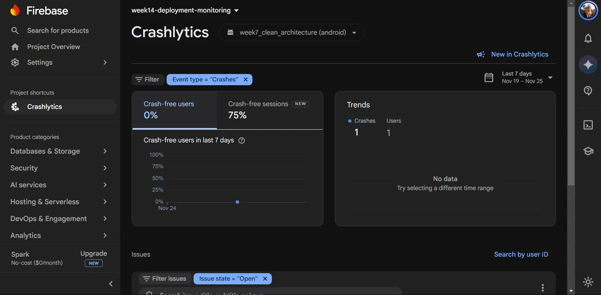 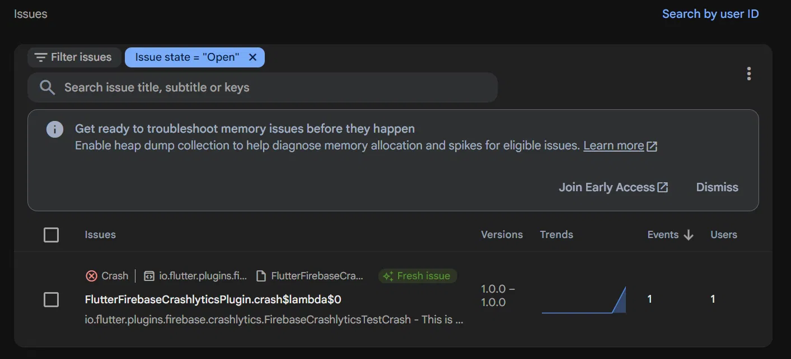 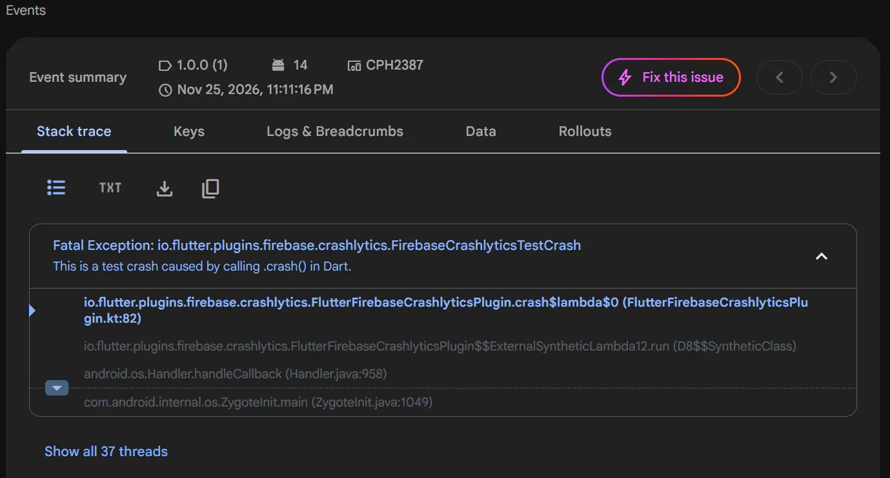 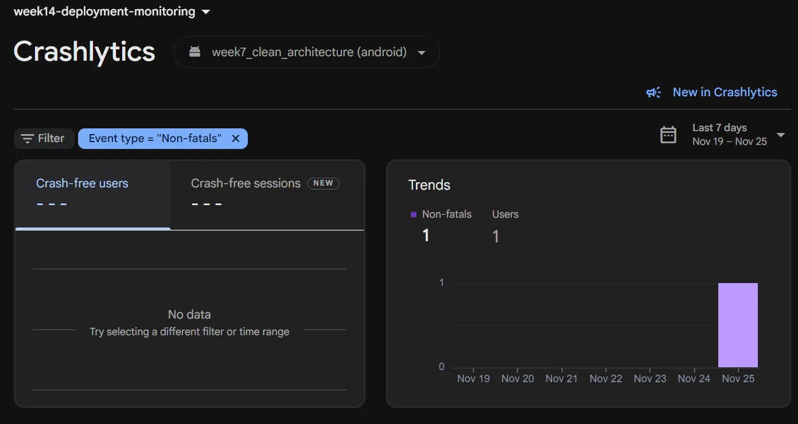 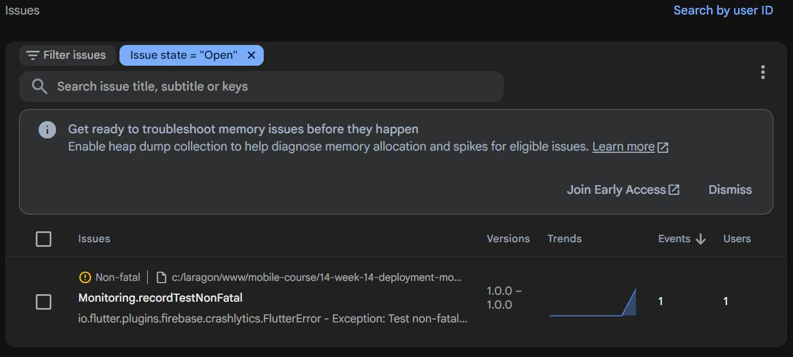 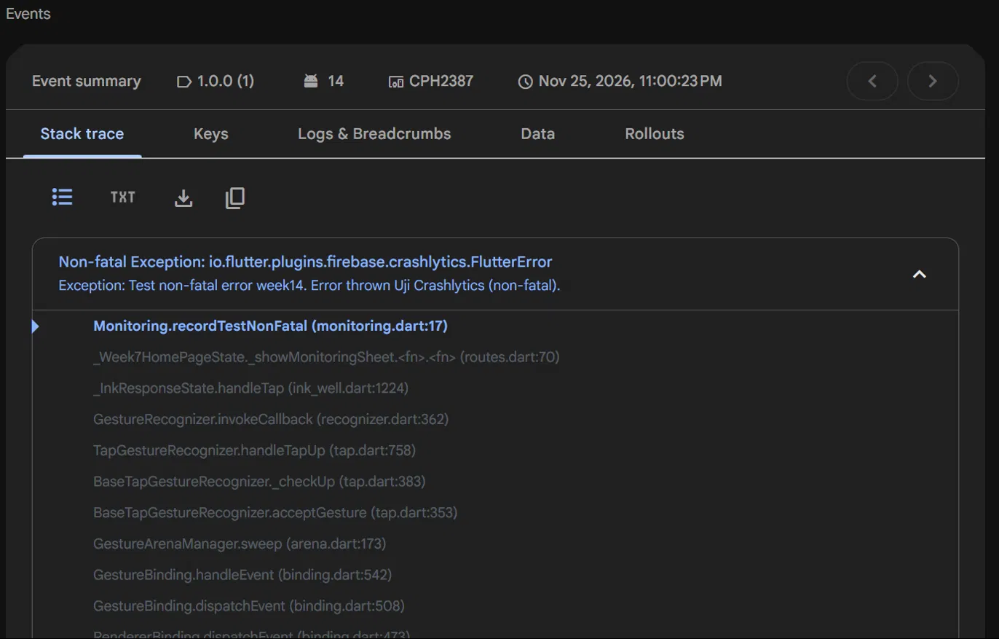

### 4.3 Analytics

- Event `beta_feedback_sent` (parameter `screen_name`) tercatat di DebugView; panel Top Events menunjukkan 4 kejadian dalam 30 menit terakhir.
- Event tidak memuat data pribadi: parameternya hanya nama layar.
- parameter `screen_name = home` terlihat di DebugView

Bukti: 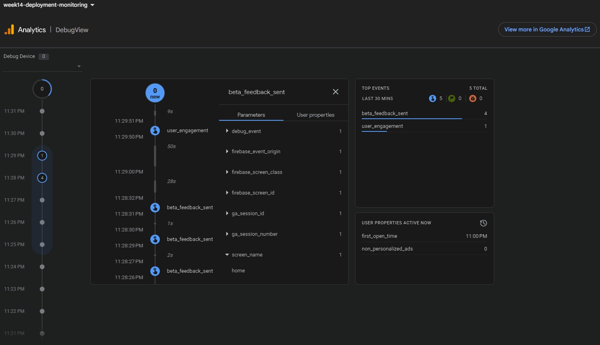

## 5. Temuan dan Dampak

| # | Temuan | Dampak | Tindak lanjut |
|---|---|---|---|
| 1 | Crash fatal dan error non-fatal tercatat di Crashlytics | Tidak ada dampak ke pengguna, keduanya dipicu sengaja untuk verifikasi monitoring | Hapus menu uji sebelum rilis ke pengguna umum |
| 2 | Build release memakai debug key | Tidak layak untuk Play Store; tidak mempengaruhi distribusi uji | Buat keystore sendiri sebelum rilis publik |
| 3 | Instalasi di HP tester lama (± 10 menit pada tester 1, ± 5 menit pada tester 2) | Pengalaman instalasi lambat, terutama pada koneksi buruk | Dicatat; di Play Store hambatan ini tidak muncul |
| 4 | Peringatan font `CupertinoIcons` saat build | Tidak menggagalkan build |

Tidak ada masalah fungsional yang dilaporkan kedua tester.

## 6. Keputusan

**Keputusan: lanjutkan ke beta terbatas berikutnya, belum ke rilis publik.**

Alasan:
- Seluruh pemeriksaan otomatis lulus dan kedua tester tidak menemukan masalah.
- Aplikasi berjalan lancar di dua perangkat dengan versi Android berbeda (Android 14 dan Android 16).
- Monitoring terbukti bekerja: crash, error non-fatal, dan event Analytics tercatat dengan versi, perangkat, dan stack trace.
- Namun bukti stabilitas masih terbatas: hanya dua tester, dua perangkat, dan pemakaian singkat. Tidak adanya masalah dari dua tester belum cukup untuk memperluas distribusi secara luas.

Syarat sebelum memperluas distribusi:
1. Menu "Paksa crash uji" dihapus atau disembunyikan dari build untuk pengguna.
2. Tambah tester di luar dua tester saat ini, dengan variasi merek perangkat dan versi Android, lalu pantau crash-free users minimal beberapa hari.
3. Ganti debug key dengan keystore sendiri, yang disimpan di luar repository.

## 7. Langkah Berikutnya

1. Hapus menu uji monitoring, naikkan versi menjadi `1.0.0+2`, lalu distribusikan ulang.
2. Tambah hingga 3–5 tester baru dengan merek HP dan versi Android yang berbeda dari dua tester sebelumnya.
3. Pantau Crashlytics selama periode beta dan tangani issue yang muncul sebelum rilis.

---